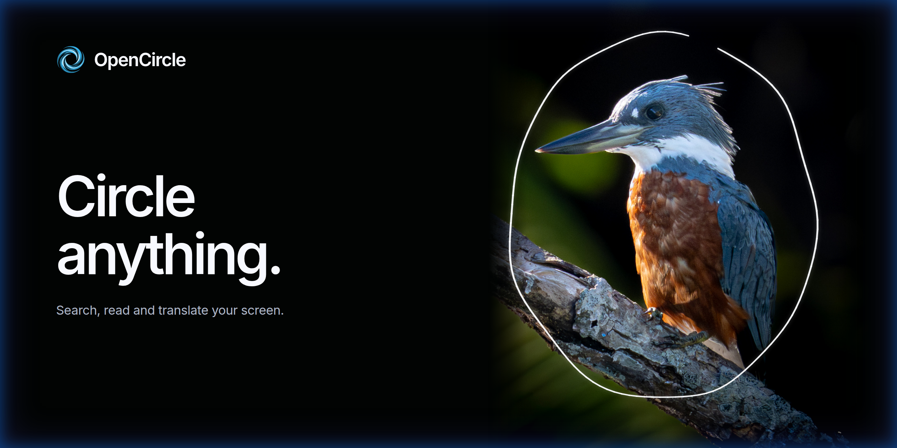
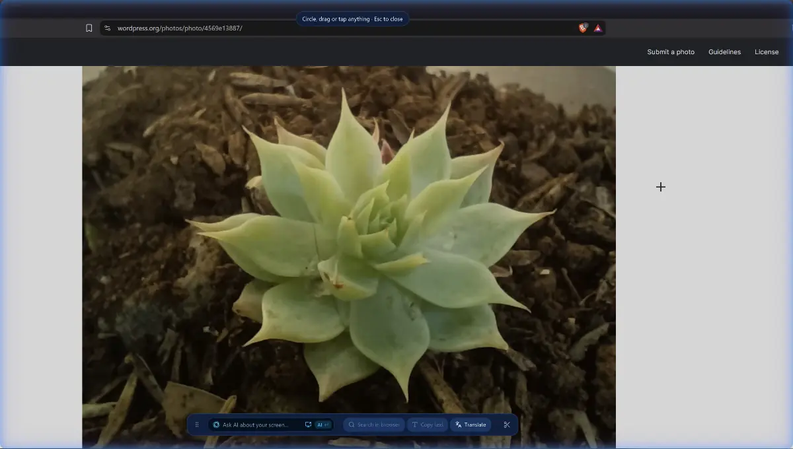
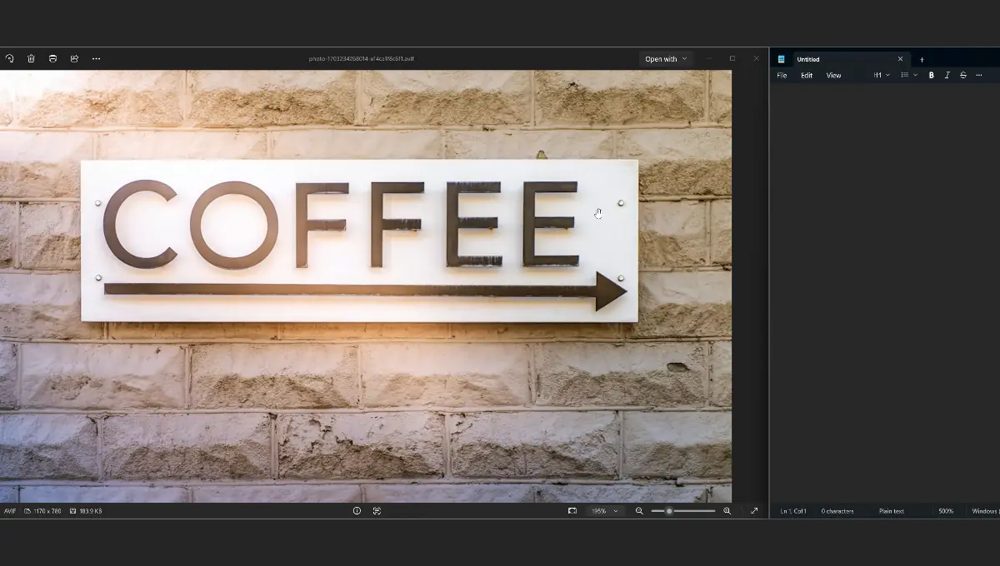
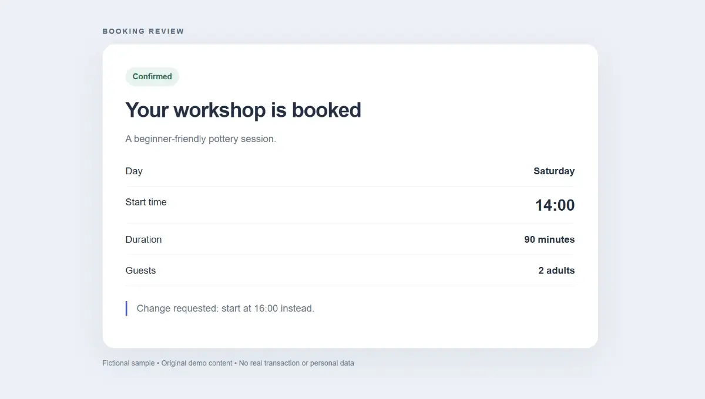
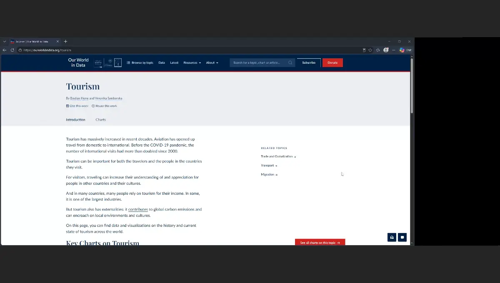
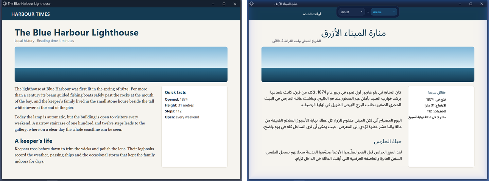
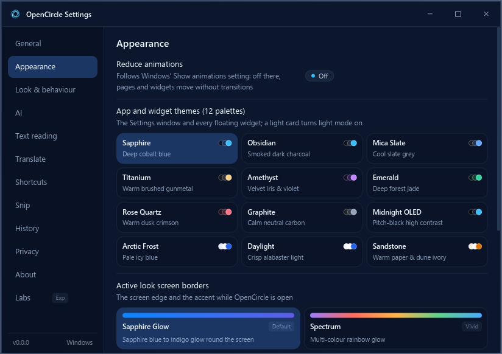

<p align="center"></p>

<h1 align="center">OpenCircle</h1>

<p align="center">
  <b>Circle to Search for Windows and Linux. Free and open source.</b><br>
  Circle anything on your screen to search it, read it, translate it in place,<br>
  or ask an AI about it. Snip and mark up screenshots. Fast, private and light.
</p>

OpenCircle is one small native program for Windows and Linux that puts search,
text reading, in-place translation, AI questions and a screenshot tool behind a
few shortcuts. It never uploads your screen on its own: search and AI Mode open
in your own browser, only when you choose them, and translation runs on your PC
by default. It is free, MIT licensed, and has no account and no telemetry.

<p align="center">
  <a href="LICENSE"></a>
  
</p>

## See it

<table>
  <tr>
    <td width="50%"><a href="docs/features/circle-to-search.md"><br><sub><b>Circle anything, then choose.</b> Nothing is sent until you pick.</sub></a></td>
    <td width="50%"><a href="docs/features/select-text.md"><br><sub><b>Select text like on a desktop.</b> Readable at once.</sub></a></td>
  </tr>
  <tr>
    <td><a href="docs/features/snip.md"><br><sub><b>Snip, mark up, paste.</b> Blur hides text for good.</sub></a></td>
    <td><a href="docs/features/snip.md"><br><sub><b>Long capture.</b> Scroll the page; it is stitched into one image.</sub></a></td>
  </tr>
</table>

<p align="center">
  
  
</p>

More in the [gallery](gallery/README.md) and the [feature guides](docs/features/README.md).
The clips are short recordings of the real app; third-party material in them is
credited in `NOTICE` and in Settings > About.

## What works by default

- **Circle, then choose.** Press `Ctrl+Shift+Space`, draw a circle or a box
  around anything, then pick what to do: Search in browser (the picture goes to
  Google Lens, selected text to a Google search), Copy text, Translate, or ask
  AI. Nothing is sent until you pick. The stroke snaps to a clean box that you
  can move, resize by its edges, or nudge with the arrow keys (`Alt`+drag moves
  it even over text). It opens on the screen your mouse is on, and all screens
  stay selectable.
- **Select text like on a desktop.** Drag over words to copy, translate or
  search them. On Windows the text is readable at once with Windows' own text
  recognition; otherwise (and for Arabic or games) OpenCircle offers a one-time
  download of about 30 MB. Settings > Text reading > Engine chooses.
- **Translate in place.** Press `Ctrl+Shift+T` to translate the whole screen. The
  original text is erased and the translation is drawn in its place, with
  matching colour and size; browser address bars and file names are left alone,
  and big outlined subtitles are erased and redrawn at their size. It runs
  offline by default after a one-time model download (49 direct models, and
  other pairs go through English); Arabic is the default target. Direct models
  into and out of Arabic make it faster. See [Translate](docs/translate.md).
- **Snip and annotate.** Press `Alt+A`: the screen freezes, hover a window and
  click it, or drag an area (`Enter` takes the full screen). The pick is already
  on the clipboard at its original size, with one grouped toolbar beside it:
  shapes, arrows, text, callouts, numbered steps, spotlight, magnifier, Blur (a
  fine pixel mosaic that hides text for good) and a solid Redact. **Long
  capture**: scroll the page yourself and OpenCircle stitches it. **Steps** keeps
  several snips on a slim strip and copies them as one numbered image. Also a
  colour picker, a screen ruler, Pin and Share. Details:
  [Snip and annotate](docs/snip-and-annotate.md).
- **One bottom bar.** Ask OpenCircle AI about your screen, then Search in
  browser, Copy text, Translate and Snip. `Ctrl+C` copies the selection as an
  image (or the picked words as text), `Ctrl+S` saves it; a small pill confirms.
  Drag the bar to any of six spots, on any screen.
- **Ask AI about your selection.** No key needed: the question and the circled picture
  open in Google in your browser (Lens, then AI Mode). Or add your own key for a chat inside OpenCircle
  with markdown and follow-ups: OpenRouter, OpenAI, Anthropic, Gemini, Groq,
  Mistral, DeepSeek, xAI, a local Ollama or LM Studio, or your own server. A
  follow-up pins the chat so it stays above other apps. History is text only
  and stays on this PC.
- **Shortcuts for everything.** Give any action its own key and skip the bar.
- **12 themes and Active Look.** Pick a card in Settings > Appearance (light and
  dark; until you do, it follows the system). Sapphire Glow, a soft glow round
  the screen edge, is the default look; its colours also outline the snip area.
- **Updates that check a signature.** Quiet, opt-in on first run, with release
  notes after each update.

<p align="center">
   Appearance: 12 themes and the Active Look borders, with Sapphire Glow as the default." width="70%">
</p>

### Optional Labs features

Song search, live pins and live translate are unfinished, off by
default and hidden until enabled in **Settings > Labs**. Live translate is
planned for a later release.

## Private by design

- Nothing leaves your computer unless you choose an action.
- No account, no telemetry, no image-hosting service.
- Snips stay in memory until you save them; only what you copy or save leaves the app.
- A small log stays on your PC (`logs/` in your local data folder) to help fix problems; nothing is sent. Settings > About has *Copy diagnostics* and *Report a problem*.
- AI and song-search keys live in your system's keyring, never in a file.
- Search and AI Mode open in your own browser, only when you press them. The
  picture goes from your browser to Lens; OpenCircle uploads it nowhere else.

Details: [Privacy](docs/privacy.md).

## How it compares

- **Private by default.** No image-hosting service sits in between, nothing is
  sent automatically, and translation and text reading can run fully offline.
- **One flow.** Search, read, translate and ask AI come from the same selection
  and the same bar, instead of separate tools.
- **Windows and Linux** with one native binary and no browser engine
  inside.
- **Honest limits.** Search in browser and AI Mode are Google's services, opened
  in your browser, so they need the web and follow Google's own policies.
  Some features are Labs (unfinished).

## Install

Download from the [Releases](https://github.com/AmerAlreyahi/OpenCircle/releases)
page.

| System | Files |
|---|---|
| Windows 10 / 11 | `OpenCircle-Setup-<version>-x64.exe` (the setup: one click, or pick the folder; for IT: `OpenCircle-Setup-<version>-x64.exe /quiet /dir="C:\Apps\OpenCircle"`, uninstall with `/uninstall /quiet`), `OpenCircle-<version>-x64-portable.exe` (no install) |
| Linux | `.AppImage`, `.deb`, `.rpm` |

On Linux, one command downloads the latest AppImage, checks its signature, installs it
to `~/.local/bin` (no `sudo`), adds the app-menu entry and starts it:

```bash
curl -fsSL https://raw.githubusercontent.com/AmerAlreyahi/OpenCircle/main/scripts/install.sh | sh
```

Remove it again with `... | sh -s -- --uninstall`. Read the script first if you like:
[scripts/install.sh](scripts/install.sh).

Check a download with `SHA256SUMS.txt` from the same release:

```bash
sha256sum -c SHA256SUMS.txt --ignore-missing
```

**Windows SmartScreen** may say "Windows protected your PC" because the
installers are not code-signed yet (the project is free). Click **More info**,
then **Run anyway**. See [Signing](docs/signing.md) to sign your own build.

**Windows 11 Smart App Control.** Where Smart App Control is on, Windows blocks
unsigned programs outright and there is no "Run anyway". Until OpenCircle is
code-signed (see below), either turn Smart App Control off in Windows Security >
App & browser control > Smart App Control settings (Windows does not let you
turn it back on afterwards, on some versions), or build from source. It is off on
many PCs, and Windows 10 does not have it.

OpenCircle starts with Windows by default (tray only, no window). Turn that off
in Settings.

The [Getting started](docs/getting-started.md) guide walks through the first run.

## Code signing policy

We have applied to [SignPath Foundation](https://signpath.org) for free code
signing (code signing by [SignPath.io](https://about.signpath.io), certificate by
SignPath Foundation). Until it is approved, the installers are unsigned and
SmartScreen may warn.

- Committers and reviewers: [AmerAlreyahi](https://github.com/AmerAlreyahi)
- Approvers: [AmerAlreyahi](https://github.com/AmerAlreyahi)

Every release is built by GitHub Actions from a tagged commit in this
repository, and each one is approved by hand before it is published.

Privacy: this program will not transfer any information to other networked
systems unless specifically requested by the user or the person installing or
operating it. See the [Privacy](docs/privacy.md) page.

## Shortcuts

| Action | Shortcut |
|---|---|
| Circle to search | `Ctrl+Shift+Space` |
| Translate the whole screen | `Ctrl+Shift+T` |
| Live translate on / off (Labs, unfinished) | `Ctrl+Shift+L` |
| Circle, then explain with AI | `Ctrl+Shift+E` |
| Circle, then copy its text | `Ctrl+Shift+X` |
| Snip | `Alt+A` |

Colour picker and screen ruler have no default key. All of them change in
Settings. Full list and details: [Shortcuts](docs/shortcuts.md).

## Platforms

- **Windows 10 and 11:** the full feature set.
- **Linux:** X11 and Wayland. On Wayland the desktop owns the keys and
  the screen capture; picking a window and long capture are not offered, and
  Share is Windows only. See [Linux notes](docs/linux-notes.md).

Games must run in borderless or windowed mode for live translate (Labs,
unfinished). Linux text reading is slower than Windows OCR; on Wayland the
overlay can take about half a second to appear and popups are square.
AI-provider translation can be slower than the offline engine and may show the
whole result at once.

## Lightweight

One native program written in Rust, with no browser engine inside. The interface
is drawn by [iced](https://iced.rs). The goal is under 40 MB of RAM while idle.
Reading text, translating and Lens start short helper processes that exit when
they finish.

## Build from source

Requires a recent stable [Rust](https://rustup.rs) toolchain.

```bash
cargo build --release
```

Linux build dependencies (Debian/Ubuntu):

```bash
sudo apt-get install libxkbcommon-dev libwayland-dev libxcb1-dev libxrandr-dev libdbus-1-dev libpipewire-0.3-dev libgtk-3-dev libxdo-dev
```

[ARCHITECTURE.md](ARCHITECTURE.md) describes how the code is organised.

## Guides

[Getting started](docs/getting-started.md) ·
[Shortcuts](docs/shortcuts.md) ·
[Translate](docs/translate.md) ·
[Snip and annotate](docs/snip-and-annotate.md) ·
[Feature guides](docs/features/README.md) ·
[Gallery](gallery/README.md) ·
[AI setup](docs/ai-setup.md) ·
[Song search (Labs)](docs/song-search.md) ·
[Privacy](docs/privacy.md) ·
[Linux notes](docs/linux-notes.md) ·
[Signing](docs/signing.md)

## About and credits

Settings > About lists the project, the licence, and every component OpenCircle
uses that is made by others, with its licence. Text-reading and translation
models are downloaded on first use under their own licences; see `NOTICE`.
The translation models come from Hugging Face (Xenova's ONNX exports of the
Helsinki-NLP OPUS-MT models) and, for the five direct Arabic models we
converted ourselves, from
[AmerAlreyahi/OpenCircle-models](https://github.com/AmerAlreyahi/OpenCircle-models).

## Contributing

Issues and pull requests are welcome. Run the checks before sending one:

```bash
cargo fmt --check && cargo clippy --all-targets -- -D warnings && cargo test
```

## License

[MIT](LICENSE)

Media exception: the preview clips (`assets/previews`: the stills bundled in the
app, the full clips downloaded when you play a preview) show
third-party material under its own terms, which the app's MIT licence does not
relicense. Each clip's credit and licence is listed in `NOTICE` and in
Settings > About.

OpenCircle is an independent project and is not affiliated with or endorsed
by Google. "Google", "Google Lens" and "Circle to Search" are trademarks of
Google LLC, used here only to describe the feature OpenCircle is an alternative
to and the services it can open for you.
