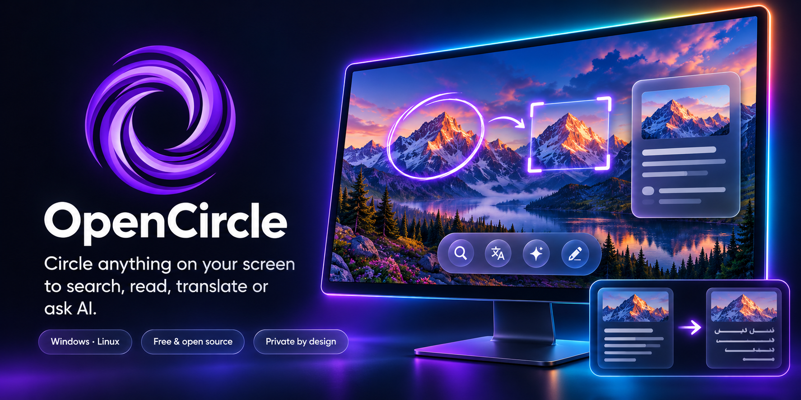
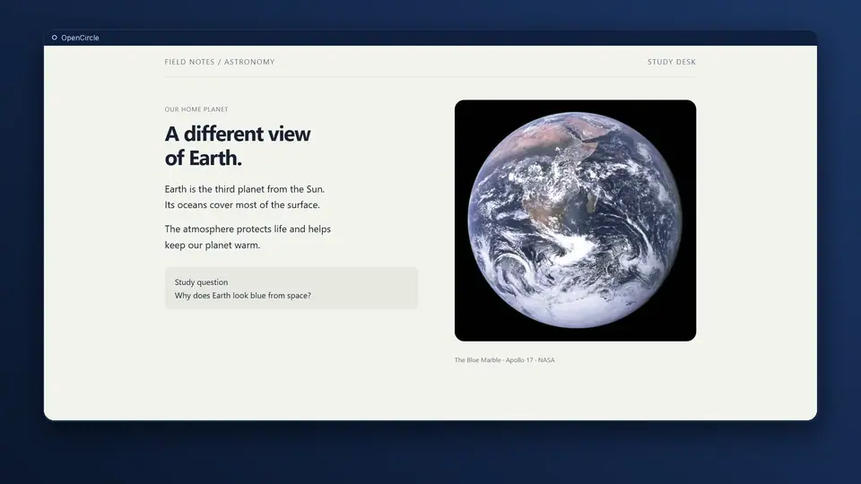
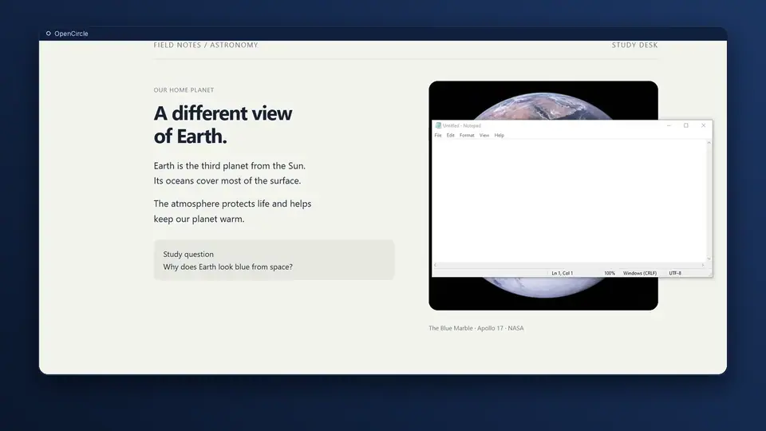
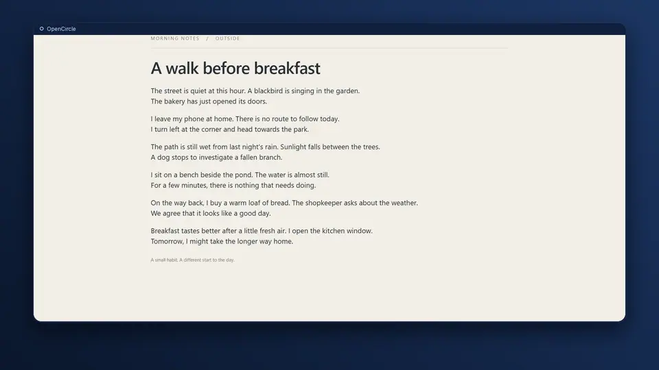
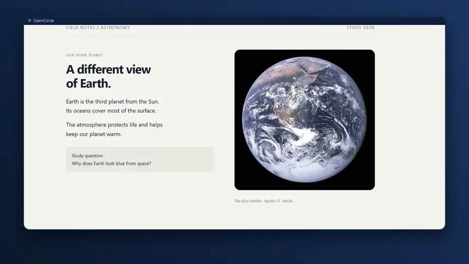
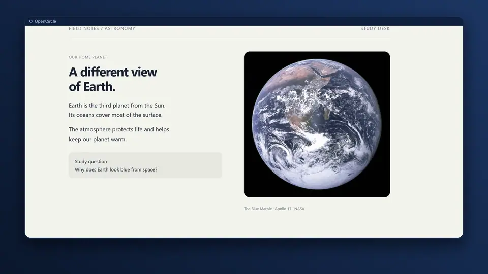
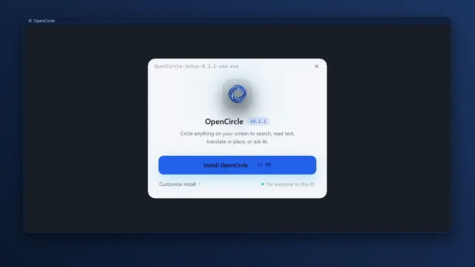
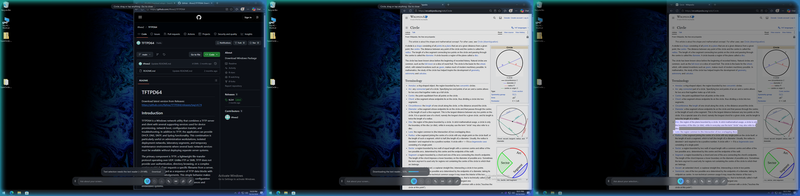

<p align="center"></p>

<h1 align="center">OpenCircle</h1>

<p align="center">
  <b>Circle to Search for Windows and Linux. Free and open source.</b><br>
  Circle anything on your screen to search it, read it, translate it in place,<br>
  or ask an AI about it. Fast, private and light.
</p>

OpenCircle is one small native program for Windows and Linux that puts search,
text reading, in-place translation and AI questions behind one shortcut. It never
uploads your screen on its own: search and AI Mode open in your own browser, only
when you choose them, and translation runs on your PC by default. It is free, MIT
licensed, and has no account and no telemetry.

<p align="center">
  <a href="LICENSE"></a>
  
</p>

## See it in action

<table>
  <tr>
    <td width="50%"><a href="docs/features/circle-to-search.md"><br><sub><b>Circle anything, then choose Search.</b> Lens opens in your own browser.</sub></a></td>
    <td width="50%"><a href="docs/features/select-text.md"><br><sub><b>Select text. Copy. Paste.</b> Text on screen is selectable at once.</sub></a></td>
  </tr>
  <tr>
    <td><a href="docs/features/translate.md"><br><sub><b>Read the page in Arabic.</b> Offline, drawn where the text stood.</sub></a></td>
    <td><a href="docs/features/selection-box.md"><br><sub><b>Adjust the box.</b> Resize, Alt+drag or arrows; Ctrl+C copies the image.</sub></a></td>
  </tr>
  <tr>
    <td><a href="docs/features/save-and-copy.md"><br><sub><b>Keep it with Ctrl+S.</b> Saved straight to your folder.</sub></a></td>
    <td><a href="docs/features/install.md"><br><sub><b>Install. Launch. Ready.</b> One small setup, then one shortcut.</sub></a></td>
  </tr>
</table>

More screenshots and the full-size videos: [gallery](gallery/README.md).

<p align="center">
  <br>
  <sub>Translate in place: the text is erased and redrawn where it stood.</sub>
</p>

## What it does

- **Translate in place, built for games.** Press `Ctrl+Shift+T` to translate
  the whole screen. The original text is erased and the translation is drawn in
  its place, with matching colour and size. Live mode keeps going while you play.
  Runs offline by default. Arabic is the default target.
- **Circle, then choose.** Press `Ctrl+Shift+Space`, draw a circle or a box
  around anything, then pick what to do: Search in browser (the picture goes to
  Google Lens, selected text to a Google search), Copy text, Translate, or ask
  AI. Nothing is sent until you pick. The stroke snaps to a clean box that you
  can move, resize by its edges, or nudge with the arrow keys (`Alt`+drag moves
  it even over text). It opens on the screen of your active window, so it works
  with several monitors.
- **Select text like on a desktop.** Drag over words to copy them, translate
  them, or search them. On Windows the text is readable at once with Windows' own
  text recognition; otherwise (and for Arabic or games) OpenCircle offers a
  one-time download of about 30 MB. Settings > Look & behaviour > Text reader
  chooses.
- **One bottom bar.** Ask OpenCircle AI about your screen, then Search in
  browser, Copy text, and Translate; Live translate, Music and Edit appear
  once you turn them on in Settings > Labs. `Ctrl+C` copies the selection as an
  image (or the picked words as text), `Ctrl+S` saves it; a small pill confirms.
  Drag the bar to any edge.
- **Labs.** Unfinished features (Snip, the image editor, song search, search
  history, pins, live translate) are off by default and hidden until you switch
  them on in Settings > Labs. Live translate is unfinished (planned for 0.3.0).
- **Snip and annotate** (Labs). Region, window, full screen or scrolling capture.
  Arrows, shapes, text, numbered steps, spotlight, a soft blur, and a solid
  Redact (use Redact, not Blur, to hide passwords). Copy puts the picture on the
  clipboard, ready for an AI chat.
- **Ask AI about your selection.** No key needed: the question opens in Google
  AI Mode in your browser. Or add your own key for answers inside OpenCircle: Claude, OpenAI, or
  any OpenAI-compatible server, including a local model.
- **Shortcuts for everything.** Give any action its own key and skip the bar.
- **Themes.** Light, dark or system colours, and seven live looks for the screen
  while OpenCircle is active.
- **Updates that check a signature.** Quiet, opt-in on first run, with release
  notes after each update.

## Private by design

- Nothing leaves your computer unless you choose an action.
- No account, no telemetry, no image-hosting service.
- A small log stays on your PC (`logs/` in your local data folder) to help fix problems; nothing is sent. Settings > About has *Copy diagnostics* and *Report a problem*.
- AI and song-search keys live in your system's keyring, never in a file.
- Search and AI Mode open in your own browser, only when you press them. The
  picture goes from your browser to Lens; OpenCircle uploads it nowhere else.

Details: [Privacy](docs/privacy.md).

<p align="center">
  <br>
  <sub>Select text: drag over words, then copy, translate or search them.</sub>
</p>

## How it compares

- **Private by default.** No image-hosting service sits in between, nothing is
  sent automatically, and translation and text reading can run fully offline.
- **One flow.** Search, read, translate and ask AI come from the same selection
  and the same bar, instead of separate tools.
- **Windows and Linux (preview)** with one native binary and no browser engine
  inside.
- **Honest limits.** Search in browser and AI Mode are Google's services, opened
  in your browser, so they need the web and follow Google's own policies.
  Linux is a preview, and some features are Labs (unfinished).

## Install

Download from the [Releases](https://github.com/AmerAlreyahi/OpenCircle/releases)
page.

| System | Files |
|---|---|
| Windows 10 / 11 | `OpenCircle-Setup-<version>-x64.exe` (the setup: one click, or pick the folder; for IT: `OpenCircle-Setup-<version>-x64.exe /quiet /dir="C:\Apps\OpenCircle"`, uninstall with `/uninstall /quiet`), `OpenCircle-<version>-x64-portable.exe` (no install) |
| Linux (preview) | `.AppImage`, `.deb`, `.rpm` |

On Linux, one command downloads the latest AppImage, checks its signature, installs it
to `~/.local/bin` (no `sudo`), adds the app-menu entry and starts it:

```bash
curl -fsSL https://raw.githubusercontent.com/AmerAlreyahi/OpenCircle/main/scripts/install.sh | sh
```

Remove it again with `... | sh -s -- --uninstall`. Read the script first if you like:
[scripts/install.sh](scripts/install.sh).

Check a download with `SHA256SUMS.txt` from the same release:

```bash
sha256sum -c SHA256SUMS.txt --ignore-missing
```

**Windows SmartScreen** may say "Windows protected your PC" because the
installers are not code-signed (the project is free). Click **More info**, then
**Run anyway**. See [Signing](docs/signing.md) to sign your own build.

OpenCircle starts with Windows by default (tray only, no window). Turn that off
in Settings.

The [Getting started](docs/getting-started.md) guide walks through the first run.

## Code signing policy

We have applied to [SignPath Foundation](https://signpath.org) for free code
signing (code signing by [SignPath.io](https://about.signpath.io), certificate by
SignPath Foundation). Until it is approved, the installers are unsigned and
SmartScreen may warn.

- Committers and reviewers: [AmerAlreyahi](https://github.com/AmerAlreyahi)
- Approvers: [AmerAlreyahi](https://github.com/AmerAlreyahi)

Every release is built by GitHub Actions from a tagged commit in this
repository, and each one is approved by hand before it is published.

Privacy: this program will not transfer any information to other networked
systems unless specifically requested by the user or the person installing or
operating it. See the [Privacy](docs/privacy.md) page.

## Shortcuts

| Action | Shortcut |
|---|---|
| Circle to search | `Ctrl+Shift+Space` |
| Translate the whole screen | `Ctrl+Shift+T` |
| Live translate on / off (Labs, unfinished) | `Ctrl+Shift+L` |
| Circle, then explain with AI | `Ctrl+Shift+E` |
| Circle, then copy its text | `Ctrl+Shift+X` |
| Snip a region / a window / the full screen (with Labs > Snip on) | `Print Screen` / `Alt+Print Screen` / `Ctrl+Print Screen` |

All of them change in Settings. Full list and details: [Shortcuts](docs/shortcuts.md).

## Platforms

- **Windows 10 and 11:** the full feature set.
- **Linux (preview):** X11 and Wayland. On Wayland the desktop owns the keys and
  the screen capture; live translate runs once per press, and window and
  scrolling snips are not offered. See [Linux notes](docs/linux-notes.md).

Games must run in borderless or windowed mode for live translate.

## Lightweight

One native program written in Rust, with no browser engine inside. The interface
is drawn by [iced](https://iced.rs). The goal is under 40 MB of RAM while idle.
Reading text, translating and Lens start short helper processes that exit when
they finish.

## Build from source

Requires a recent stable [Rust](https://rustup.rs) toolchain.

```bash
cargo build --release
```

Linux build dependencies (Debian/Ubuntu):

```bash
sudo apt-get install libxkbcommon-dev libwayland-dev libxcb1-dev libxrandr-dev libdbus-1-dev libpipewire-0.3-dev libgtk-3-dev libxdo-dev
```

[ARCHITECTURE.md](ARCHITECTURE.md) describes how the code is organised.

## Guides

[Getting started](docs/getting-started.md) ·
[Shortcuts](docs/shortcuts.md) ·
[Translate](docs/translate.md) ·
[Snip and annotate](docs/snip-and-annotate.md) ·
[AI setup](docs/ai-setup.md) ·
[Song search](docs/song-search.md) ·
[Privacy](docs/privacy.md) ·
[Linux notes](docs/linux-notes.md) ·
[Signing](docs/signing.md)

## About and credits

Settings > About lists the project, the licence, and every component OpenCircle
uses that is made by others, with its licence. Text-reading and translation
models are downloaded on first use under their own licences; see `NOTICE`.

## Contributing

Issues and pull requests are welcome. Run the checks before sending one:

```bash
cargo fmt --check && cargo clippy --all-targets -- -D warnings && cargo test
```

## License

[MIT](LICENSE)

OpenCircle is an independent project and is not affiliated with or endorsed
by Google. "Google", "Google Lens" and "Circle to Search" are trademarks of
Google LLC, used here only to describe the feature OpenCircle is an alternative
to and the services it can open for you.
