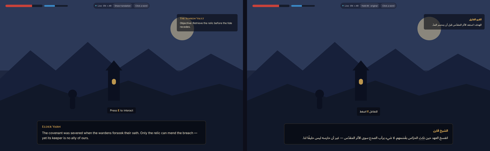

<p align="center">
  
</p>

<h1 align="center">OpenCircle</h1>

<p align="center">
  <b>The open-source alternative to Circle to Search for Windows and Linux.</b><br>
  Circle anything on your screen to search it, read it, translate it in place, ask an AI about it, or snip and annotate it.<br>
  Fast, private and lightweight.
</p>

<p align="center">
  <a href="LICENSE"></a>
  
</p>

<p align="center">
  <br>
  <sub>Design concept of in-place translation. More in the <a href="gallery/README.md">gallery</a>.</sub>
</p>

## What it does

Android has Circle to Search; the PC never got it. Press a shortcut and the
screen freezes. Circle, drag or tap anything (text, images, video frames,
games) and choose what to do with it.

- **Translate in place, built for games.** Every piece of text is erased and
  redrawn in your language where it stood, with matching colour and size, not
  a box laid on top. Arabic and many more target languages. A live mode keeps
  translating while you play (Windows and X11). Hold `Alt` to peek at the
  original; click a block for its meaning in context.
  See [Translate](docs/translate.md).
- **Search with Google Lens in your own browser.** The picture goes from your
  browser straight to Lens. No image-hosting service in between.
- **Read text from anything.** Copy text out of images, videos and games. OCR
  runs on your PC, offline, after a one-time download of about 20 MB.
- **Ask AI about what you circled.** By default your question opens in Google
  AI Mode in your own browser: no key, no account. Or bring your own key for
  answers in the app, with follow-up questions: Claude, or any
  OpenAI-compatible service, including a local model with Ollama or LM Studio,
  or OpenRouter. See [AI setup](docs/ai-setup.md).
- **Snip and annotate.** Region, window, full-screen and scrolling captures.
  Smart shapes, curved arrows, callouts, numbered steps, text, highlighter,
  spotlight, magnifier and blur that cannot be reversed. Copy or save.
  See [Snip and annotate](docs/snip-and-annotate.md).
- **Quick-action shortcuts.** Give an action its own global shortcut and skip
  the menu. See [Shortcuts](docs/shortcuts.md).
- **Light, dark and system themes.**

## Private by design

- Nothing leaves your computer until you choose an action.
- No accounts, no telemetry, no image-hosting services.
- API keys live in your operating system's keyring, never in a file.
- Temporary files are deleted when you are done.

Details: [Privacy](docs/privacy.md).

## Lightweight

One native program written in Rust, with no browser engine inside. It uses
about 20–30 MB of RAM while it waits in the tray in our tests (Windows and
Linux). Reading text starts a short-lived helper process that uses more memory
while it works and exits afterwards.

## Install

Download from the [Releases](https://github.com/AmerAlreyahi/OpenCircle/releases)
page:

| System | Files |
|---|---|
| Windows 10 / 11 | `.exe` installer (NSIS) or `.msi` |
| Linux | `.AppImage`, `.deb`, `.rpm` |

Verify a download with `SHA256SUMS.txt` from the same release:

```bash
sha256sum -c SHA256SUMS.txt --ignore-missing
```

**Windows SmartScreen.** Binaries are not code-signed (a certificate costs
money and the project is free), so Windows may show "Windows protected your
PC". Click **More info**, then **Run anyway**. You or your organisation can
sign the installer with your own certificate: see [Signing](docs/signing.md).

**Linux runtime libraries.** The `.deb` and `.rpm` pull in what is needed
(GTK 3, AppIndicator, X11/xcb, xkbcommon, Wayland client libraries and
`xdg-desktop-portal`). The AppImage needs the same libraries on the host.
Without AppIndicator the tray icon is missing but the app still runs from its
shortcuts and the command line. See [Linux notes](docs/linux-notes.md).

## First run

OpenCircle starts in the tray and shows a short welcome: your shortcut, an
optional AI provider, and a theme. Press `Ctrl+Shift+Space`, circle something,
and pick an action. [Getting started](docs/getting-started.md) walks through it.

## Default shortcuts

| Action | Shortcut |
|---|---|
| Circle to search | `Ctrl+Shift+Space` |
| Translate the full screen | `Ctrl+Shift+T` |
| Live translate on / off | `Ctrl+Shift+L` |
| Circle, then explain with AI | `Ctrl+Shift+E` |
| Circle, then copy text | `Ctrl+Shift+X` |
| Snip a region / window / full screen | `Print Screen` / `Alt+Print Screen` / `Ctrl+Print Screen` |

All of them can be changed in Settings. Snip mode also opens from the tray menu
or with `opencircle run snip`. On Windows, `Print Screen` may belong to the
system; [Shortcuts](docs/shortcuts.md) says how to free it. On Wayland, the
desktop asks once to allow shortcuts; where it cannot, bind the commands in
your desktop's keyboard settings. Full list: [Shortcuts](docs/shortcuts.md).

## Platforms

- **Windows** 10 and 11.
- **Linux** on X11 and Wayland. On Wayland, global shortcuts need a desktop
  with the GlobalShortcuts portal (GNOME 48+, KDE Plasma 6); elsewhere you bind
  `opencircle capture` yourself. Some features depend on what the compositor
  allows. See [Linux notes](docs/linux-notes.md).

Games must run in borderless or windowed mode for live translate: no app can
draw over exclusive fullscreen.

## Build from source

Requires a recent stable [Rust](https://rustup.rs) toolchain.

```bash
cargo build --release
```

Linux build dependencies (Debian/Ubuntu):

```bash
sudo apt-get install libxkbcommon-dev libwayland-dev libxcb1-dev libxrandr-dev libdbus-1-dev libpipewire-0.3-dev libgtk-3-dev libxdo-dev
```

[ARCHITECTURE.md](ARCHITECTURE.md) describes how the code is organised.

## Guides

[Getting started](docs/getting-started.md) ·
[Shortcuts](docs/shortcuts.md) ·
[AI setup](docs/ai-setup.md) ·
[Translate](docs/translate.md) ·
[Snip and annotate](docs/snip-and-annotate.md) ·
[Privacy](docs/privacy.md) ·
[Linux notes](docs/linux-notes.md) ·
[Signing](docs/signing.md)

## Contributing

Issues and pull requests are welcome. Please run the checks before sending a
pull request:

```bash
cargo fmt --check && cargo clippy --all-targets -- -D warnings && cargo test
```

## License

[MIT](LICENSE)

OpenCircle is an independent project and is not affiliated with or endorsed
by Google. "Google", "Google Lens" and "Circle to Search" are trademarks of
Google LLC, used here only to describe the feature OpenCircle offers an
alternative to and the service it can open for you.
