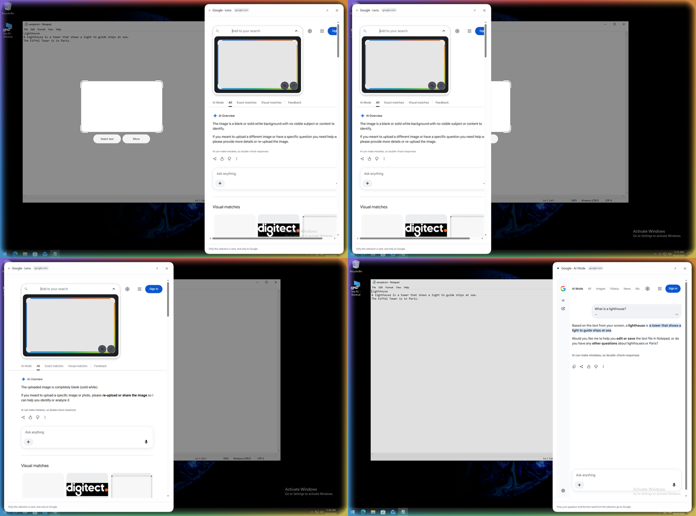

<p align="center"></p>

<h1 align="center">OpenCircle</h1>

<p align="center">
  <b>Circle to Search for Windows and Linux. Free and open source.</b><br>
  Circle anything on your screen to search it, read it, translate it in place,<br>
  or ask an AI about it. Fast, private and light.
</p>

<p align="center">
  <a href="LICENSE"></a>
  
</p>

<p align="center">
  <br>
  <sub>Translate in place: the text is erased and redrawn where it stood.</sub>
</p>

## What it does

- **Translate in place, built for games.** Press `Ctrl+Shift+T` to translate
  the whole screen. The original text is erased and the translation is drawn in
  its place, with matching colour and size. Live mode keeps going while you play.
  Runs offline by default. Arabic is the default target.
- **Circle to search.** Press `Ctrl+Shift+Space`, draw a circle or a box around
  anything, and it is searched at once. The stroke snaps to a clean box.
- **Select text like on a desktop.** Drag over words to copy them, translate
  them, or search them. Text reading is a one-time download of about 30 MB.
- **Results in a card, not a new tab.** Google Lens and AI Mode open in a
  floating card beside your selection. Dock it left or right, drag it, resize
  it. Open in your browser only when you click.
- **One bottom bar.** Your question, then Copy, Save, Translate, Live translate,
  Music and Edit. Drag it to any edge.
- **Snip and annotate.** Region, window, full screen or scrolling capture.
  Arrows, shapes, text, numbered steps, blur, spotlight. Copy the image and its
  text in one go, ready for an AI chat.
- **Ask AI about your selection.** No key needed: the question opens in Google
  AI Mode. Or add your own key for answers inside OpenCircle: Claude, OpenAI, or
  any OpenAI-compatible server, including a local model.
- **Shortcuts for everything.** Give any action its own key and skip the bar.
- **Themes.** Default, Frost and Graphite, in light, dark or system colours.
  Seven live looks for the screen while OpenCircle is active.
- **Updates that check a signature.** Quiet, opt-in on first run, with release
  notes after each update.

## Private by design

- Nothing leaves your computer unless you choose an action.
- No account, no telemetry, no image-hosting service.
- AI and song-search keys live in your system's keyring, never in a file.

Details: [Privacy](docs/privacy.md).

<p align="center">
  <br>
  <sub>Select text: drag over words, then copy, translate or search them.</sub>
</p>

<p align="center">
  <br>
  <sub>The results card: Lens and AI Mode, docked beside the selection.</sub>
</p>

## Install

Download from the [Releases](https://github.com/AmerAlreyahi/OpenCircle/releases)
page.

| System | Files |
|---|---|
| Windows 10 / 11 | `.msi` installer (pick the folder, optional launch at the end), `.exe` installer |
| Linux (preview) | `.AppImage`, `.deb`, `.rpm` |

On Linux, one command downloads the latest AppImage, checks its signature, installs it
to `~/.local/bin` (no `sudo`), adds the app-menu entry and starts it:

```bash
curl -fsSL https://raw.githubusercontent.com/AmerAlreyahi/OpenCircle/main/scripts/install.sh | sh
```

Remove it again with `... | sh -s -- --uninstall`. Read the script first if you like:
[scripts/install.sh](scripts/install.sh).

Check a download with `SHA256SUMS.txt` from the same release:

```bash
sha256sum -c SHA256SUMS.txt --ignore-missing
```

**Windows SmartScreen** may say "Windows protected your PC" because the
installers are not code-signed (the project is free). Click **More info**, then
**Run anyway**. See [Signing](docs/signing.md) to sign your own build.

OpenCircle starts with Windows by default (tray only, no window). Turn that off
in Settings.

The [Getting started](docs/getting-started.md) guide walks through the first run.

## Shortcuts

| Action | Shortcut |
|---|---|
| Circle to search | `Ctrl+Shift+Space` |
| Translate the whole screen | `Ctrl+Shift+T` |
| Live translate on / off | `Ctrl+Shift+L` |
| Circle, then explain with AI | `Ctrl+Shift+E` |
| Circle, then copy its text | `Ctrl+Shift+X` |
| Snip a region / a window / the full screen | `Print Screen` / `Alt+Print Screen` / `Ctrl+Print Screen` |

All of them change in Settings. Full list and details: [Shortcuts](docs/shortcuts.md).

## Platforms

- **Windows 10 and 11:** the full feature set.
- **Linux (preview):** X11 and Wayland. On Wayland the desktop owns the keys and
  the screen capture; live translate runs once per press, and window and
  scrolling snips are not offered. See [Linux notes](docs/linux-notes.md).

Games must run in borderless or windowed mode for live translate.

## Lightweight

One native program written in Rust, with no browser engine inside. The interface
is drawn by [iced](https://iced.rs). The goal is under 40 MB of RAM while idle.
Reading text, translating and Lens start short helper processes that exit when
they finish.

## Build from source

Requires a recent stable [Rust](https://rustup.rs) toolchain.

```bash
cargo build --release
```

Linux build dependencies (Debian/Ubuntu):

```bash
sudo apt-get install libxkbcommon-dev libwayland-dev libxcb1-dev libxrandr-dev libdbus-1-dev libpipewire-0.3-dev libgtk-3-dev libxdo-dev
```

[ARCHITECTURE.md](ARCHITECTURE.md) describes how the code is organised.

## Guides

[Getting started](docs/getting-started.md) ·
[Shortcuts](docs/shortcuts.md) ·
[Translate](docs/translate.md) ·
[Snip and annotate](docs/snip-and-annotate.md) ·
[AI setup](docs/ai-setup.md) ·
[Song search](docs/song-search.md) ·
[Privacy](docs/privacy.md) ·
[Linux notes](docs/linux-notes.md) ·
[Signing](docs/signing.md)

## About and credits

Settings > About lists the project, the licence, and every component OpenCircle
uses that is made by others, with its licence. Text-reading and translation
models are downloaded on first use under their own licences; see `NOTICE`.

## Contributing

Issues and pull requests are welcome. Run the checks before sending one:

```bash
cargo fmt --check && cargo clippy --all-targets -- -D warnings && cargo test
```

## License

[MIT](LICENSE)

OpenCircle is an independent project and is not affiliated with or endorsed
by Google. "Google", "Google Lens" and "Circle to Search" are trademarks of
Google LLC, used here only to describe the feature OpenCircle is an alternative
to and the services it can open for you.
