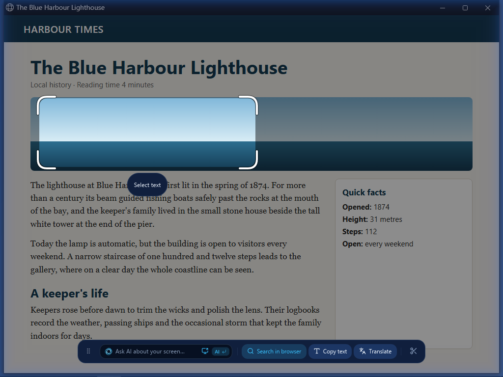
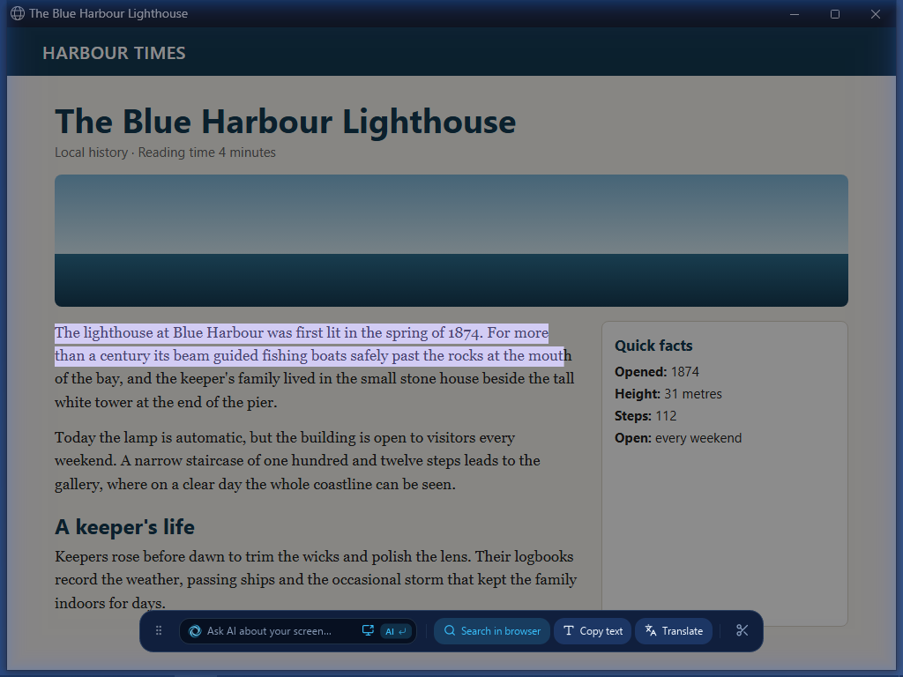
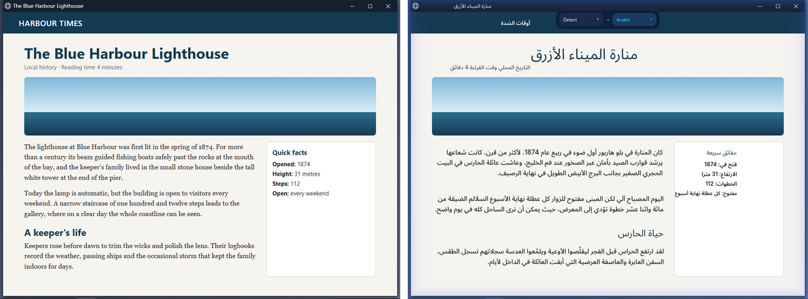

# OpenCircle features

Seven short guides to OpenCircle. Open one for the steps, shortcuts, and limits.

| | |
|---|---|
|  [Circle to Search](circle-to-search.md) |  [Select text](select-text.md) |
|  [Translate in place](translate.md) |  [Adjust the selection box](selection-box.md) |
|  [Snip](snip.md) | [Save and copy](save-and-copy.md) [Install OpenCircle](install.md) |

The short recordings of the real app are in the [gallery](../gallery/README.md).

[Back to README](../../README.md)
