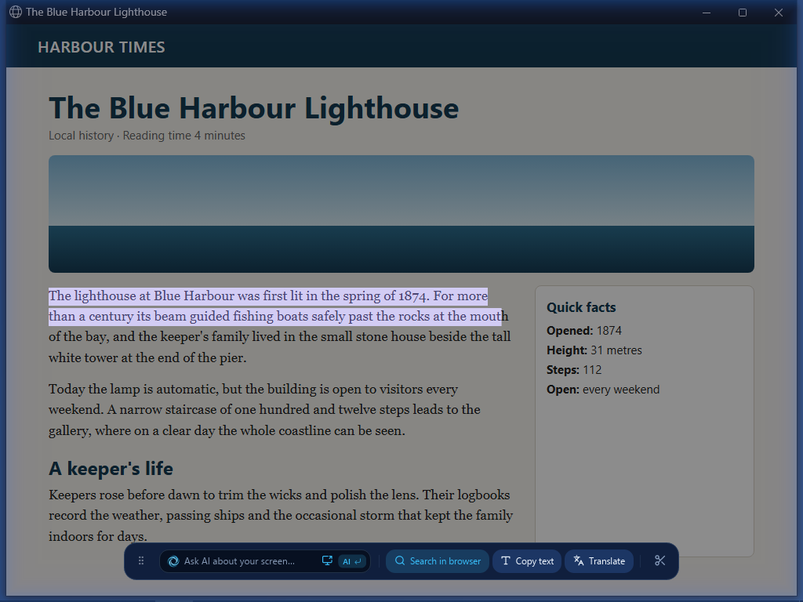

  

# Select text

Select text from what you can see, even when the original app will not let you copy it.

## How to

1. Press `Ctrl+Shift+Space` to open the overlay.
2. On Windows, Windows OCR reads the screen as the overlay opens. On Linux, accept the text reader download if asked, then allow it time to read.
3. Drag across characters. Double-click for a word or triple-click for a line.
4. Press `Ctrl+C`, then paste into another app. Use `Ctrl+A` to select all recognised text on the screen.
5. On Windows, choose **Auto**, **Fast** (Windows' own reader) or **Accurate** (the downloaded reader) under **Settings › Text reading › Engine**.

## Shortcuts

| Shortcut | What it does |
|---|---|
| `Ctrl+Shift+Space` | Open the overlay |
| Drag over text | Select characters |
| Double-click / triple-click | Select a word / a line |
| `Shift+click` | Extend the text selection |
| `Ctrl+C` | Copy selected text |
| `Ctrl+A` | Select all recognised screen text |
| Right-click on the selection (or the Menu key / `Shift+F10`) | Copy, Search the web, Ask AI, Translate, Select all text; Open link or Send email when the selection is one |
| `Esc` | Close the overlay; leave the question field first if focused |

## Right-click menu

Right-click on selected text for the actions you would look for: **Copy**,
**Search the web**, **Ask AI** (opens the chat with the selected text attached, for
you to type your question), **Translate** and **Select all text**; a selected web
address or email also offers **Open link** / **Send email**. It opens only on the
selection: right-drag to pan and double right-click to reset the zoom work
everywhere else. Arrow keys and `Enter` work in it, `Esc` closes it.

## Tips

- Windows OCR makes text selectable as soon as it is read, without a model download when Windows has the language installed.
- **Auto** uses Windows OCR where suitable and falls back to the downloaded reader when needed. Try **Accurate** for text Windows misses.
- On Windows, Arabic and pages that mix two languages are read line by line, each line by the reader that suits it. While the screen is still being read, the **Copy text** button spins (its tooltip counts the lines) and unread lines show the busy cursor.
- To copy a picture instead, draw a box around it. See [Save and copy](save-and-copy.md).

## Limits

- Recognition can miss small, stylised, or low-contrast text. Check the result before pasting it somewhere important.
- Windows OCR depends on the recognition languages installed in Windows.
- Latin words and digits inside an Arabic line are often missed, and a page that mixes English and Arabic takes longer to read.
- Arabic and pages that mix languages are read part by part on Windows and on Linux; small Arabic text can still be read less well on Linux.
- Linux is a preview. It uses the downloaded reader and is slower; the **Text reading** page is Windows-only.
- `Ctrl+A` may wait while the rest of the screen is read.

---

[Previous: Circle to Search](circle-to-search.md) · [Next: Translate in place](translate.md) · [All features](README.md) · [Back to README](../../README.md)
