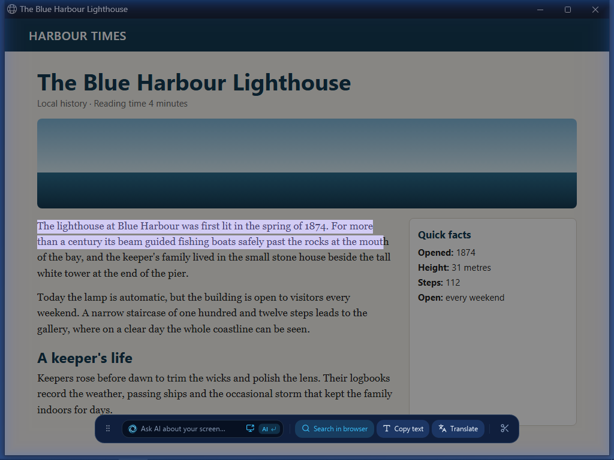

  

# Select text

Select text from what you can see, even when the original app will not let you copy it.

## How to

1. Press `Ctrl+Shift+Space` to open the overlay.
2. On Windows, Windows OCR reads the screen as the overlay opens. On Linux, accept the text reader download if asked, then allow it time to read.
3. Drag across characters. Double-click for a word or triple-click for a line.
4. Press `Ctrl+C`, then paste into another app. Use `Ctrl+A` to select all recognised text on the screen.
5. On Windows, choose **Auto**, **Fast** (Windows' own reader) or **Accurate** (the downloaded reader) under **Settings › Text reading › Engine**.

## Shortcuts

| Shortcut | What it does |
|---|---|
| `Ctrl+Shift+Space` | Open the overlay |
| Drag over text | Select characters |
| Double-click / triple-click | Select a word / a line |
| `Shift+click` | Extend the text selection |
| `Ctrl+C` | Copy selected text |
| `Ctrl+A` | Select all recognised screen text |
| `Esc` | Close the overlay; leave the question field first if focused |

## Tips

- Windows OCR makes text selectable as soon as it is read, without a model download when Windows has the language installed.
- **Auto** uses Windows OCR where suitable and falls back to the downloaded reader when needed. Try **Accurate** for text Windows misses.
- On Windows, Arabic and pages that mix two languages are read line by line, each line by the reader that suits it. While the screen is still being read, the **Copy text** button spins (its tooltip counts the lines) and unread lines show the busy cursor.
- To copy a picture instead, draw a box around it. See [Save and copy](save-and-copy.md).

## Limits

- Recognition can miss small, stylised, or low-contrast text. Check the result before pasting it somewhere important.
- Windows OCR depends on the recognition languages installed in Windows.
- Latin words and digits inside an Arabic line are often missed, and a page that mixes English and Arabic takes longer to read.
- On Linux, Arabic in the overlay is read the way it was before 0.1.7 (the line-by-line reading comes to Linux later).
- Linux is a preview. It uses the downloaded reader and is slower; the **Text reading** page is Windows-only.
- `Ctrl+A` may wait while the rest of the screen is read.

---

[Previous: Circle to Search](circle-to-search.md) · [Next: Translate in place](translate.md) · [All features](README.md) · [Back to README](../../README.md)
