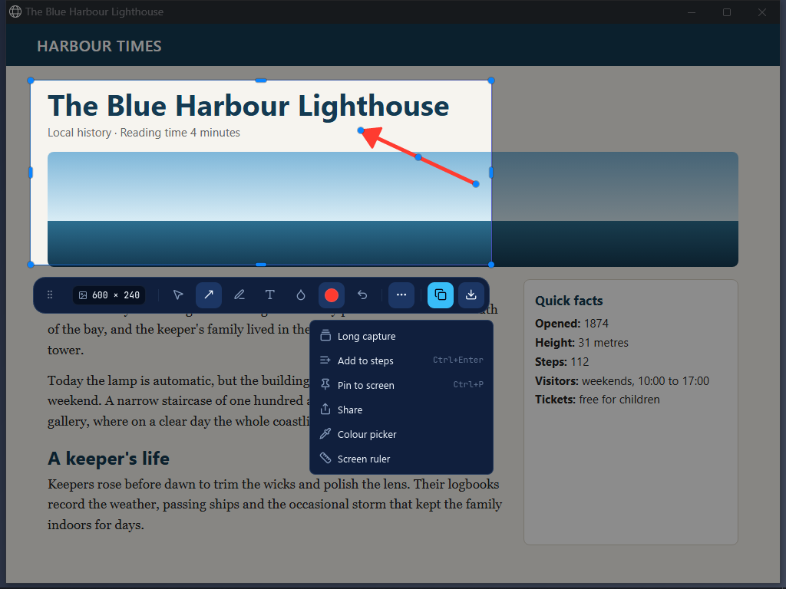
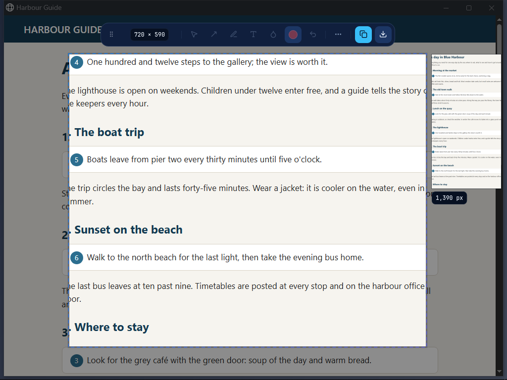
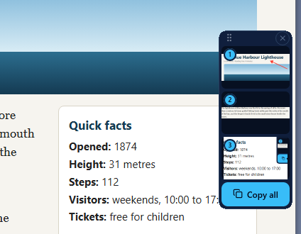

  

# Snip

Take a screenshot, mark it up, and paste it into an AI chat or any app in seconds.

## How to

1. Press `Alt+A`. The screen freezes and a glow round its edge shows it is captured.
2. Hover a window and click it, or drag to draw your own area. `Enter` takes the full screen.
3. The picked area is already on the clipboard, and the toolbar opens beside it.
4. Mark it up if you like: click a tool, then drag on the picture.
5. Press **Copy** to copy it again with your marks, or **Save** to write it to a file. `Esc` closes the toolbar.

## Shortcuts

| Shortcut | What it does |
|---|---|
| `Alt+A` | Start Snip (change it in Settings > Shortcuts) |
| `Enter` / `Shift+Enter` | Full screen of the pointer's screen / all screens as one picture |
| Arrow keys | Nudge the area (`Shift` = 10 px, `Ctrl`+arrows resize) |
| `V` `A` `P` `T` `B` | Select, Arrow, Pen, Text, Blur |
| `Ctrl+C` / `Ctrl+S` | Copy / Save |
| `Ctrl+Z` / `Ctrl+Shift+Z` | Undo / Redo |
| `Ctrl+Enter` | Add to steps |
| `Esc` | Clear the area, then close |

All tool keys are in [Snip and annotate](../snip-and-annotate.md).

## More than a screenshot

  

- **Long capture** for a page taller than the screen. Pick the area, then **More > Long capture** and scroll the page yourself; OpenCircle stitches it into one tall image and shows the page so far beside the area. **Copy** or **Save** finishes it.

  

- **Steps** (**More > Add to steps**) puts a capture on a slim strip at the screen edge so you can go to another window and snip the next step. **Copy all** puts every step on the clipboard as one numbered image.

  

- **Colour picker** (click copies `#RRGGBB`) and **Screen ruler** (measure in real pixels) are in More and can have their own shortcut.
- **Pin to screen** keeps the picture on top of your windows. **Share** opens Windows' share sheet.
- **Blur** is a fine pixel mosaic that hides text for good. **Redact** is a solid box.

## Tips

- Copy and Save keep the capture's original size. **Settings > Snip** can scale the long edge down instead, set a timer, or draw the mouse pointer in.
- Drag the size chip on the toolbar into any app to drop the picture there.
- If `Alt+A` is taken by another app (some screenshot tools use it), give Snip another key in Settings > Shortcuts.

## Limits

- Picking a window by hovering and Long capture are not offered on Wayland; drag an area instead. See [Linux notes](../linux-notes.md).
- Share is Windows only.
- Long capture scrolls down only, and an area across screens is captured on the screen that holds most of it.
- Steps hold up to 12 captures and live in memory only.

---

[Previous: Save and copy](save-and-copy.md) · [Next: Install OpenCircle](install.md) · [All features](README.md) · [Back to README](../../README.md)
