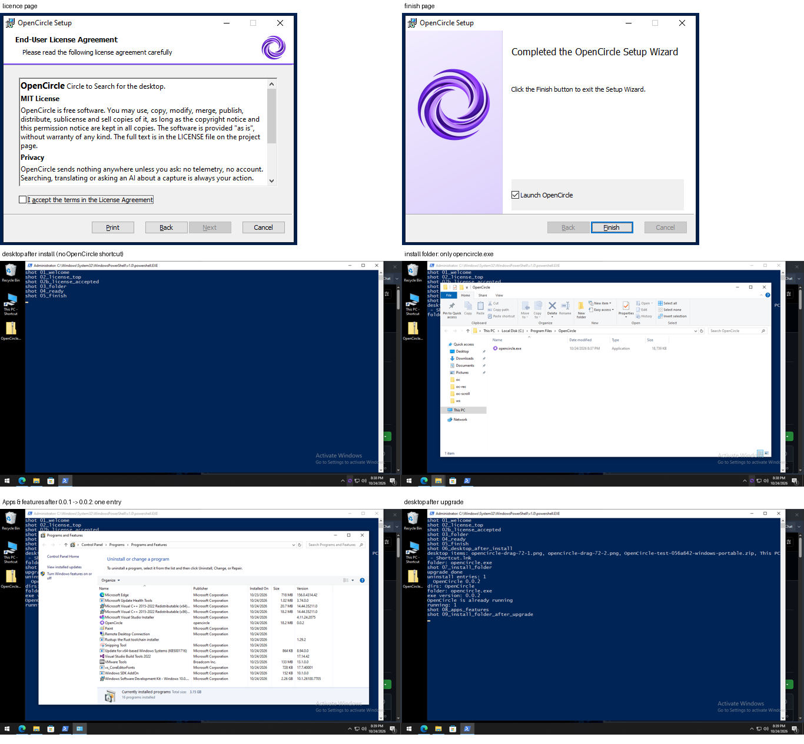
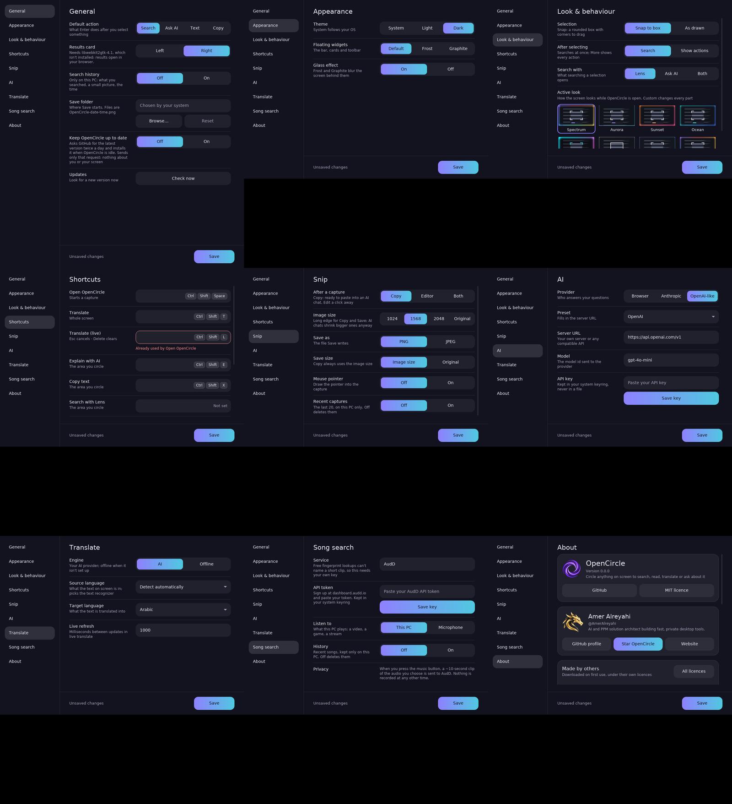

# Getting started

## Install

Download the installer from the [Releases](https://github.com/AmerAlreyahi/OpenCircle/releases)
page (see the [README](../README.md#install)).

- **Windows:** run the `.msi` (or the `.exe`). The installer asks for the
  install folder and, at the end, whether to launch OpenCircle.
- **Linux (preview):** install the `.deb` or `.rpm`, or run the `.AppImage`.

  

OpenCircle lives in the system tray. Starting it again while it runs hands the
request to the running copy. It starts with Windows by default; turn that off
in **Settings > General**.

## First run

A short welcome shows your shortcut, an optional AI provider and a theme. Skip
any of it; everything can change later in **Settings** (tray menu).

Auto-update is asked about once, on first run. It is off until you say yes. See
[Updates](#updates).

## Circle something

1. Press `Ctrl+Shift+Space`, or choose **Circle to search** in the tray menu.
   The screen freezes under a light dim.
2. Draw a circle, or drag a box, around what you want. The stroke snaps to a
   rounded box with corner brackets, and the search starts at once in the
   results card (Google Lens). Drawing again starts over.
3. Use the bottom bar for the rest. `Esc` closes everything.

Settings > Look & behaviour can change this: keep the drawn shape, or wait for
you to press an action.

## The bottom bar

One bar does everything. It starts with a drag handle, then the question field,
then the rest:

| Control | What it does | Key |
|---|---|---|
| Question field | Asks AI about the selection (or the screen). `Enter` sends it | Click it first |
| Include screen | Turns the selection into "about my screen" on or off | |
| Copy | Copies the selection as an image | `Ctrl+C` |
| Save | Saves it as a PNG or JPEG, where you choose | `Ctrl+S` |
| Translate | Translates the selection in place | |
| Live translate | Keeps translating the screen while you play | `Ctrl+Shift+L` |
| Music | Finds a song from a short clip (only after you add a key; see [Song search](song-search.md)) | |
| Edit | Turns the bar into the annotation toolbar. A back arrow returns | `E` |

The bar snaps to the bottom centre, the top, or a bottom corner. Drag its
handle to move it; it stays where you put it.

Copy and Save are dimmed until something is selected. Without a selection, the
whole screen is used.

## Select text

Drag over words in a boxed selection, the way you would on a desktop. The words
highlight. Then:

- **Copy** copies the picked words.
- **Translate** translates them.
- Search sends them to the results card.

The first time you select text, OpenCircle asks before downloading the
text reader. It is about 30 MB (the app shows the exact size), checked against
pinned checksums and stored on your PC:

- Windows: `%LOCALAPPDATA%\OpenCircle\ocr`
- Linux: `~/.local/share/OpenCircle/ocr`

After that, reading text works offline. The built-in reader handles English
(Latin script) text. On a fresh Windows install the
[Microsoft Visual C++ Redistributable](https://aka.ms/vs/17/release/vc_redist.x64.exe)
may be needed; OpenCircle tells you if it is.

  

   
  Copy gives exactly the picked words. Translate, the results card and live translate work from the same selection.

## Results card

Lens and AI Mode open in a floating card beside the selection:

- It is inset from the screen edges, with rounded corners and a shadow.
- Drag it to a side to dock it left or right. Resize it; OpenCircle remembers
  the size.
- If the card would cover the selection, it opens on the other side.
- **Open in browser** is there, but nothing opens in your browser until you
  click it.

Google sign-in does not work inside the card. The optional search history
(off by default) is kept on this PC only.

  

## Translate and live translate

- `Ctrl+Shift+T` translates the whole screen once, in place. `Esc` closes it.
- `Ctrl+Shift+L` turns live translate on or off. It keeps translating as the
  screen changes.
- Hold `Alt` to see the original; release to see the translation again.

Pick the languages in **Settings > Translate**. The default target is Arabic.
Translation runs on your PC by default. See [Translate](translate.md).

## Snip and annotate

- `Print Screen` snips a region, `Alt+Print Screen` a window,
  `Ctrl+Print Screen` the full screen.
- Copy puts the image on the clipboard, ready to paste into an AI chat. On
  Windows, the copy also carries the text OpenCircle reads from it.
- Edit opens the annotation toolbar. Move any drawing, change its style and
  text options, and use the board for notes.

  

Details: [Snip and annotate](snip-and-annotate.md).

## Customize

**Settings > Look & behaviour**:

- **Selection**: snap to a box, or keep the shape you drew.
- **After selecting**: search at once, or show the bar and wait.
- **Search with**: Lens, Ask AI or both.
- **Active look**: how the screen looks while OpenCircle is open. Spectrum (the
  default), Aurora, Sunset, Ocean, Neon, Mono and Calm, or Custom: your own
  colours, glow, dim, corners and a screen edge per mode.

**Settings > Appearance** sets the app theme (System, Light or Dark) and the
floating widgets (Default, Frost or Graphite), with glass effect on or off.

  

Changes apply when you press Save. Nothing needs a restart.

## Updates

With **Settings > General > Keep OpenCircle up to date** on, OpenCircle asks
GitHub for the latest release about twice a day, only while it is idle. The
request carries no account or ID. A new release is downloaded with its
checksums and a signature from the project; OpenCircle installs it only when
the signature checks out. The next start shows the release notes.

On Linux packages (`.deb`, `.rpm`), OpenCircle does not replace itself. It
shows the release page instead.

  

**Settings > General > Updates > Check now** looks at once, on request.

## Settings and config file

Settings (tray menu) has General, Appearance, Look & behaviour, Shortcuts,
Snip, AI, Translate, Song search and About. It writes a plain TOML file you may
also edit by hand:

- Windows: `%APPDATA%\opencircle\config.toml`
- Linux: `~/.config/opencircle/config.toml`

An invalid value falls back to its default with a warning in the log and never
crashes the app. API keys are never in this file.

## Troubleshooting

- **Nothing happens on the shortcut.** Another app may own that key; pick a
  different one in Settings. On Windows, `Print Screen` may belong to the system:
  see [Shortcuts](shortcuts.md). On Wayland see [Linux notes](linux-notes.md).
- **No tray icon on Linux.** Install AppIndicator support (Debian/Ubuntu:
  `libayatana-appindicator3-1`, Fedora: `libayatana-appindicator-gtk3`). The
  shortcuts and `opencircle capture` still work.
- **Results card does not open.** Settings > General says why. Without the
  system web view, results open in your browser when you click.
- **Logs.** OpenCircle prints warnings to standard error. Start it from a
  terminal to see them.
