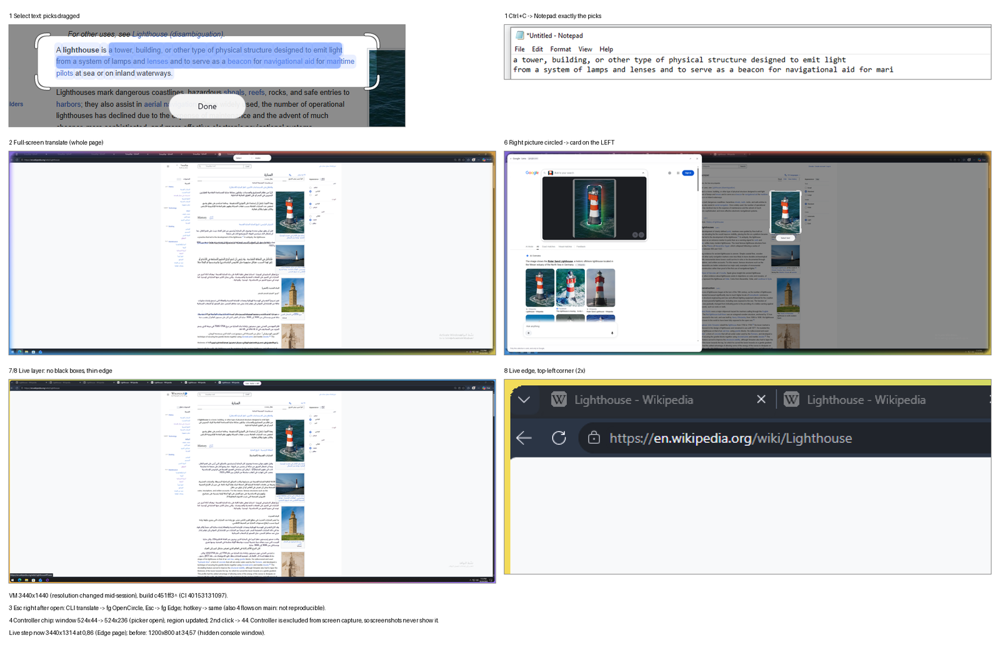
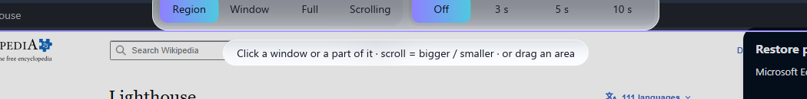
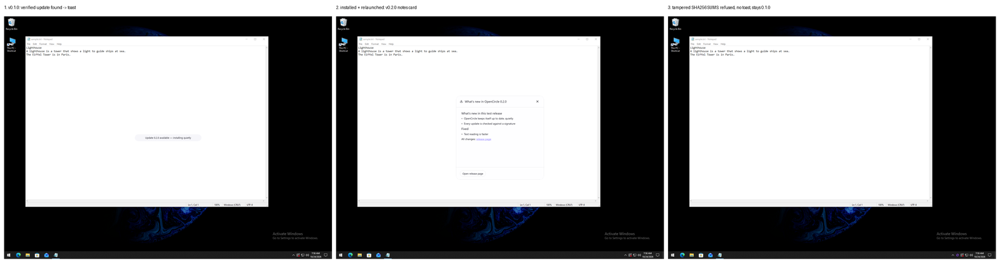

# Getting started

## Install

Download the installer from the [Releases](https://github.com/AmerAlreyahi/OpenCircle/releases)
page (see the [README](../README.md#install)).

- **Windows:** run `OpenCircle-Setup-<version>-x64.exe` and click **Install
  OpenCircle** (Windows asks for permission once). **Customize install** picks
  another folder. At the end choose whether OpenCircle starts with Windows, then
  **Launch OpenCircle**. Running a newer setup updates OpenCircle in place and
  keeps your settings and downloaded models; running the same one again repairs it.
  Uninstall it in **Settings > Apps**: it asks whether your settings, downloaded
  models and saved keys go too.
- **Windows, managed PCs:** the same setup runs silently, as administrator:
  `OpenCircle-Setup-<version>-x64.exe /quiet /dir="C:\Apps\OpenCircle"` (`/dir`
  is for a fresh install; an update stays where OpenCircle is; `/norestart` is
  accepted). Silent uninstall: `OpenCircle-Setup-<version>-x64.exe /uninstall /quiet`,
  which keeps every user's data. The exit code is 0, or Windows Installer's error
  code (for example 1925: not run as administrator). In a script, wait for it:
  `Start-Process .\OpenCircle-Setup-<version>-x64.exe -Wait -PassThru -ArgumentList "/quiet"`.
- **Windows, no install:** `OpenCircle-<version>-x64-portable.exe` runs as it is.
- **Linux (preview):** install the `.deb` or `.rpm`, or run the `.AppImage`.

OpenCircle lives in the system tray. Left-click its icon to open Settings; right-click for the menu (Circle to Search, Translate screen, Settings, Quit). Starting it again while it runs hands the
request to the running copy. It starts with Windows by default; turn that off
in **Settings > General**.

## First run

A short welcome shows your shortcut, an optional AI provider, a theme (12 to pick from) and
whether OpenCircle starts with Windows. Skip any of it; everything can change
later in **Settings** (tray menu). If a second launch finds it already running,
it opens Settings.

Auto-update is asked about once, on first run, where the switch starts on; you
can turn it off there or later in Settings. See
[Updates](#updates).

## Circle something

1. Press `Ctrl+Shift+Space`, or choose **Circle to search** in the tray menu.
   The screen freezes under a light dim.
2. Draw a circle, or drag a box, around what you want. The stroke snaps to a
   rounded box with corner brackets. Nothing is sent yet. Drawing again starts
   over.
3. Choose in the bottom bar: **Search in browser**, **Copy text**,
   **Translate**, or ask OpenCircle AI. `Esc` closes everything.

Settings > Look & behaviour can change this: keep the drawn shape, or run a
search as soon as you select (**Auto action**).

The box can be adjusted before you choose: drag inside it to move it (not over
text; hold `Alt` to move it over text), drag its edges or corners to resize it,
and use the arrow keys to nudge it (`Shift` = 10 px; `Ctrl`+arrows resize from
the bottom-right). It opens on the screen your mouse is on, so it works with several monitors. Scroll the mouse wheel to zoom the frozen screen and drag with the middle button to pan.

## The bottom bar

One bar does everything. It starts with a drag handle, then the question field,
then the rest:

| Control | What it does | Key |
|---|---|---|
| Ask OpenCircle AI field | Asks AI about the selection (or the screen); the answer opens in a chat card (see [Ask AI](#ask-ai)) | Click it first |
| Search in browser | Opens the selection in your default browser: a picture goes to Google Lens, selected text to a Google search | `L` |
| Copy text | Copies the selection's text straight to the clipboard (there is no text panel) | `Ctrl+C` |
| Translate | Translates the selection in place (no selection: the whole screen) | |
| Live translate (Labs, unfinished) | Keeps translating the screen while you play | `Ctrl+Shift+L` |
| Music | Finds a song from a short clip (Settings > Labs; see [Song search](song-search.md)) | |
| Snip | Turns the bar into the annotation toolbar (Settings > Labs). A back arrow returns | `E` |

`Ctrl+C` copies the selection as an image only (picked words are copied as text) and
`Ctrl+S` saves it as a PNG or JPEG in your save folder (Settings > General).
A small pill at the bottom right says "Copied" or "Saved to ..." for a moment.

The bar snaps to the bottom centre, the top, or a bottom corner. Drag its
handle to move it; it stays where you put it.

Search in browser and Copy text are dimmed until something is selected. A
selection of one plain colour is never sent: OpenCircle says so instead.

## Select text

Drag over words in a boxed selection, the way you would on a desktop. The words
highlight. Then:

- **Copy** copies the picked words.
- **Translate** translates them.
- **Search in browser** searches them in your default browser.

On Windows, text is read at once by Windows' own text recognition, for the
languages installed in Windows. Otherwise (Linux, Arabic, or if you choose
**Settings > Text reading > Engine > Accurate**), the first time you
select text OpenCircle shows a small card asking before downloading its text reader. It is about 30 MB
(the card shows the exact size), checked against pinned checksums and stored on
your PC:

- Windows: `%LOCALAPPDATA%\OpenCircle\ocr`
- Linux: `~/.local/share/OpenCircle/ocr`

After that, reading text works offline. On a fresh Windows install the
[Microsoft Visual C++ Redistributable](https://aka.ms/vs/17/release/vc_redist.x64.exe)
may be needed; OpenCircle tells you if it is.

  

   
  Copy gives exactly the picked words. Translate and live translate work from the same selection.

## Ask AI

Type a question in the bar's AI field and press `Enter`. With **Include screen**
on (the default) the selected area goes with it; off sends only your question.

- With no key, the question opens in Google AI Mode in your browser.
- With a provider set up (Settings > AI), the answer streams into a chat card
  with markdown. Ask a follow-up and the chat pins: it stays open above other
  apps, and a new capture asks into the same chat. The pin button in the header
  unpins and closes it. **Settings > AI > AI chat stays open** changes this.
- Each provider has its own key, kept in the system keyring and shown as dots.
- Chats are saved on this PC as text (never screenshots). The drawer's History
  lists them; delete one or clear all. **Settings > AI > Keep chat history**
  turns saving off and deletes the saved chats. See [AI setup](ai-setup.md).

## Translate and live translate

- `Ctrl+Shift+T` translates the whole screen once, in place. `Esc` closes it.
- `Ctrl+Shift+L` turns live translate on or off (a Labs feature: unfinished, off
  until you switch it on in **Settings > Labs**; planned for 0.3.0). It keeps translating as the
  screen changes.
- Hold `Alt` to see the original; release to see the translation again.

Pick the languages in **Settings > Translate**. The default target is Arabic.
Translation runs on your PC by default (Settings > Translate > Engine: Offline); choose AI there to send page text to your AI provider. See [Translate](translate.md).

## Snip and annotate

Snip, the editor, song search, search history, pins and live translate are in **Settings > Labs**: off by default,
unfinished, and hidden everywhere until you turn them on.

- `Print Screen` snips a region, `Alt+Print Screen` a window,
  `Ctrl+Print Screen` the full screen.
- Copy puts the picture only on the clipboard, ready to paste into an AI chat.
  Copy text from a selection when you want the words.
- Blur is a soft smoothing and is not made for secrets: use **Redact** (a solid
  box) to hide passwords and similar.
- Snip opens the annotation toolbar. Move any drawing, change its style and
  text options, and use the board for notes.

  

Details: [Snip and annotate](snip-and-annotate.md).

## Customize

**Settings > Look & behaviour**:

- **Selection**: snap to a box, or keep the shape you drew.
- **Auto action**: wait for you to choose (the default: nothing is sent), or
  run **Search with** as soon as you select.
- **Search with**: Lens, Ask AI or both.

**Settings > Appearance** has 12 themes (pick a card: it sets the theme and its light or dark mode; until you pick one, OpenCircle follows Windows) and the screen-border looks shown while OpenCircle is open (Spectrum is the default), or Custom: your own colours, glow, dim, corners and a screen edge per mode.

**Settings > Labs** switches the unfinished features on (Snip, Image editor,
Song search, Search history, Pins). They are off by default.

Changes save by themselves. Nothing needs a restart.

## Updates

With **Settings > General > Keep OpenCircle up to date** on, OpenCircle asks
GitHub for the latest release about twice a day, only while it is idle. The
request carries no account or ID. A new release is downloaded with its
checksums and a signature from the project; OpenCircle installs it only when
the signature checks out. The next start shows the release notes.

On Linux packages (`.deb`, `.rpm`), OpenCircle does not replace itself. It
shows the release page instead.

  

**Settings > General > Updates > Check now** looks at once, on request.

## Settings and config file

Settings (tray icon, left-click) has a sidebar with General, Appearance, Look & behaviour, AI, Text reading, Translate,
Shortcuts, Privacy, About and Labs (Snip and Song search appear
once switched on in Labs). It writes a plain TOML file you may
also edit by hand:

- Windows: `%APPDATA%\opencircle\config.toml`
- Linux: `~/.config/opencircle/config.toml`

An invalid value falls back to its default with a warning in the log and never
crashes the app. API keys are never in this file.

## Troubleshooting

- **Nothing happens on the shortcut.** Another app may own that key; pick a
  different one in Settings. On Windows, `Print Screen` may belong to the system:
  see [Shortcuts](shortcuts.md). On Wayland see [Linux notes](linux-notes.md).
- **No tray icon on Linux.** Install AppIndicator support (Debian/Ubuntu:
  `libayatana-appindicator3-1`, Fedora: `libayatana-appindicator-gtk3`). The
  shortcuts and `opencircle capture` still work.
- **Something broke.** OpenCircle keeps a small log on your PC (see
  [Privacy](privacy.md)). **Settings > About > Copy diagnostics** puts a report
  (no keys, no folders) on your clipboard, and **Report a problem** opens a
  pre-filled GitHub issue in your browser. Nothing is sent by OpenCircle.
