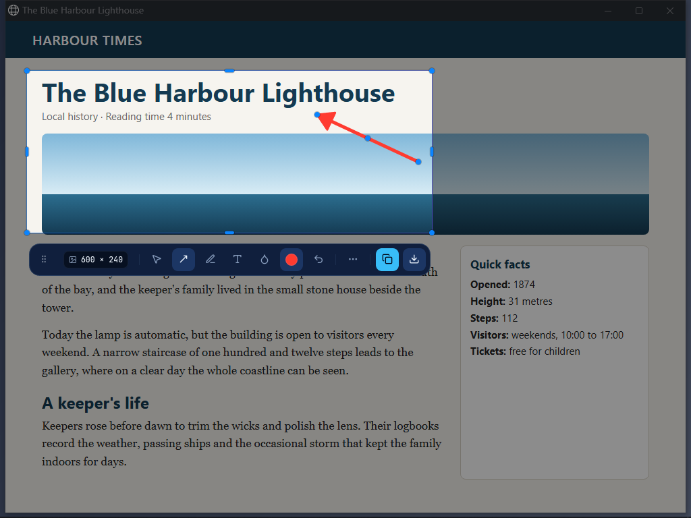
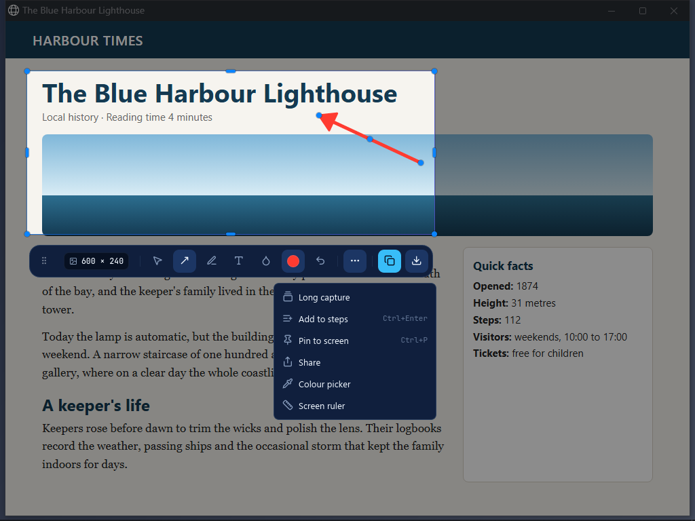
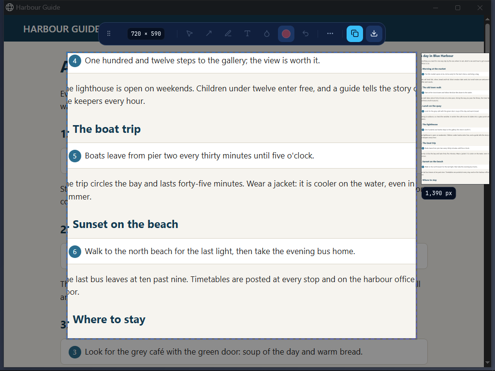
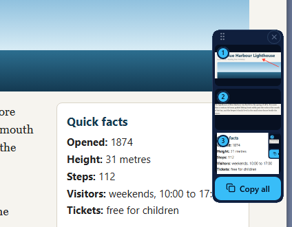

# Snip and annotate

Take a screenshot, mark it up, and paste it into an AI chat in seconds. Snip is
one flow, whichever way you start it.

  

## Take a snip

Press `Alt+A` (the default; change it in Settings > Shortcuts), choose **Snip**
in the tray menu, press the Snip button on
the bar (over a screen you already froze), or run `opencircle run snip`. The
screen freezes and a glow around its edge shows it is captured. Then:

- **Hover** a window: its whole frame is outlined, with its name and size. Click
  to take it. Scroll the wheel down to outline a part of it instead (a toolbar,
  a panel, a button; Windows), and back up to step out to the window.
- **Drag** to draw your own area; its exact size is shown. Edges snap to windows
  and their parts; hold `Shift` to place them freely.
- **Press `Enter`** for the full screen (the screen under the pointer;
  `Shift+Enter` takes all screens as one picture). An area may cross screens.

OpenCircle's own floating widgets (the Steps strip, a pin, the AI chat, a pill)
count as windows here: hover one and click to take it. They never appear in any
other capture. On Wayland there is no window list: a click takes the screen
under the pointer, like `Enter`.

**Snip a translated page.** With a translation on screen, Snip (the Snip button
in the translate pill, after the language chips, or `Alt+A`, or the tray) takes
the screen as you see it, translation included. Drag an area, or click or press
`Enter` for the screen; then mark it up, copy, save or add it to Steps as usual.

Everything also works with a finger or a pen on a touch screen. A loupe beside the pointer shows the pixels under it at 8x. `Esc` cancels.

Once an area is picked, the edge glow goes away and the area gets a soft outline
with small handles. Drag the handles to resize, drag inside to move it, use the
arrow keys to nudge (`Shift` = 10 px, `Ctrl`+arrows resize).

The same flow starts from the bar's Snip button: if you had already selected an
area, that area is the pick.

## After the pick

A pick always opens the Snip toolbar beside the area. By default a pick
copies nothing: press `Ctrl+C` or **Copy** when you want it on the clipboard.
Turn **Copy when picked** on in **Settings > Snip** to copy the area at the
moment you pick it.

Copy and Save keep the capture's **original size**. Settings > Snip can scale
the long edge down to 1024, 1568 or 2048 px instead. Copy is the picture only;
text is copied by selecting it. Drag the size chip on the toolbar to drag the
picture straight into any app, on any screen.

**Timer** (Settings > Snip: Off / 3 s / 5 s / 10 s): the overlay hides and
counts down, so you can open a menu or a tooltip first.

**Mouse pointer** (Settings > Snip, off by default) draws the pointer into the
capture.

## The toolbar

One bar, in groups: a grip to move it, the size chip, **Select**, **Shapes**,
**Draw**, **Text**, **Hide** (blur and redact), **Colour**, **Undo**, **More**,
**Copy** and **Save**. Click a tool to turn it on; click the active tool again
to open its options (outline, fill, size, and so on). `Esc` closes the toolbar.

**More** holds three actions on the picked area, then Long capture, Add to
steps, Pin, Live pin, Share (Windows), Colour picker and Screen ruler:

- **Copy text** puts the text of the area on the clipboard.
- **Ask AI** opens the AI chat with the picture, drawings included (with no AI
  key it opens Google AI Mode in your browser).
- **Translate** translates the text in place inside the area; the row then says
  **Show original**. Copy, Save and drag-out give the translated picture.

Each of the three shows your own shortcut for the same action (Settings >
Shortcuts; by default `Ctrl+Shift+X`, `Ctrl+Shift+E`, `Ctrl+Shift+T`), and that
key acts on the area while Snip is open. The area is read once, when More opens.
Copy text and Translate read the capture under your drawing and never the parts
you hid with Blur or Redact (or that a Spotlight dims). During a long capture,
Copy text and Ask AI finish the capture first; Translate is off.

  

Every tool has a key:

| Tool | Key |
|---|---|
| Select | `V` |
| Crop | `X` |
| Rectangle / Ellipse | `R` / `O` |
| Arrow (drag the middle to curve it) | `A` |
| Pen (rough shapes snap to clean ones) | `P` |
| Highlighter | `H` |
| Text | `T` |
| Callout | `C` |
| Numbered step | `N` |
| Blur | `B` |
| Redact | `K` |
| Spotlight (dims everything else) | `S` |
| Magnifier | `M` |

`Ctrl+Z` undoes, `Ctrl+Shift+Z` redoes, `Ctrl+V` pastes the clipboard's text (into
the text being typed, else as a new text). Annotations stay editable until you copy
or save. With a drawing tool a plain drag always draws; to move an annotation,
use **Select** or hold `Ctrl` and drag. A selected annotation shows only its own
small handles. OpenCircle remembers your last tool, colour, sizes and options.

**Blur or Redact.** Blur is a fine pixel mosaic along a text line, sized to the
line (or set by hand in its options). It is a soft pixel mosaic that hides the
text so it can't be recovered. **Redact** is a solid box, for when you want no
trace at all. If the stroke overshoots, slide the pointer back and the blur
follows it.

## Long capture

For a page taller than the screen: pick the area, then **More > Long capture**.
Scroll the page yourself (wheel, scrollbar or keys); OpenCircle stitches what
passes through the area into one tall image and shows the whole page so far
beside it. Scrolling back up adds nothing twice, and bars that stay put (a site's
header, a chat's message box) are kept once. **Copy** or **Save** finishes it.

  

It stops at 20,000 px by default (Settings > Snip > Long capture: 5,000, 10,000
or 20,000). Nothing is scrolled for you, and only the area is grabbed.

On Wayland the page so far, with Copy, Save, Done and Cancel, shows in a small
pop-up beside the area, and the tray icon shows a record dot while it runs: see
[Linux notes](linux-notes.md#long-capture-on-wayland).

## Steps

**More > Add to steps** (`Ctrl+Enter`) puts the capture, with its annotations, on
a small floating strip and closes the overlay, so you can go to another window or
screen. Each next snip becomes the next numbered step. Click a step to copy it,
drag to reorder, double-click to edit it, `x` to delete. **Copy all**
(`Ctrl+Shift+C`) puts every step on the clipboard as one numbered image, handy
for explaining a process to an AI. Up to 12 steps; they are kept in memory only.

  

## Colour picker and screen ruler

- **Colour picker:** a loupe follows the pointer. Click copies the colour as
  `#RRGGBB`; `Shift`+click copies `rgb(r, g, b)`. The last eight colours stay in
  the toolbar for this run.
- **Screen ruler:** measure a line (any angle; `Shift` for 0/45/90), a run of
  like colour across or up and down, or a box. Sizes are in real pixels.
  `Ctrl+C` copies the reading.

Both are in More, and can have their own shortcut (unset by default: see
[Shortcuts](shortcuts.md)).

## Pin

**Pin** (`Ctrl+P`) keeps the image on screen in a small always-on-top window.
Drag it, scroll to zoom, hover for Copy, Save and Close; `Esc` or a double-click
closes it. **Live pin** (a Labs feature, Settings > Labs > Pins; Windows) keeps a
window's picked area updating live in a pin.

## Save

**Save** (`Ctrl+S`) writes a PNG or JPEG where you choose, starting in the folder
from **Settings > Snip**. Nothing is written to disk until you save.

**Recent** (Settings > History, off by default) keeps your last captures on this
PC only; turning it off deletes them.
