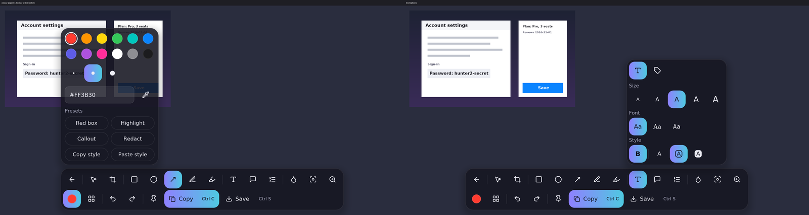

# Snip and annotate

> **Labs.** Snip and the image editor are unfinished and hidden until you turn them on in
> **Settings > Labs** (Pins, in the editor, has its own switch there).

Take a screenshot and mark it up. The same editor is also available on any
circled selection: press `E` in the action bar.

## Take a snip

Press `Print Screen` (region), `Alt+Print Screen` (window) or
`Ctrl+Print Screen` (full screen), or open Snip mode from the tray menu
(**Snip**) or with `opencircle run snip`. All of these can be changed
([Shortcuts](shortcuts.md)). Choose a mode:

| Mode | How |
|---|---|
| Region | Point at a window: it is outlined, with its name and size; click to take it. Point at a part of it (a toolbar, a panel, a button; Windows) to outline just that part, and scroll the wheel to step out to the bigger part, the window, the whole screen (and back). Or drag a rectangle, or circle an area. |
| Window | Click a window |
| Full | The whole screen |

While you drag, the edges snap to windows and, on Windows, to their buttons,
fields and panels; hold `Shift` to place them freely. On Wayland there is no
window list: drag or circle the area. A loupe beside
the pointer shows the pixels under it at 8x, with their position and colour.

**Scrolling capture**: pick an area, then press the scrolling button in the
editor toolbar. OpenCircle scrolls the page under the area and stitches the
pieces into one tall image (the progress pill is kept out of it). `Esc` or Stop
keeps what was gathered.

**Timer** (Settings → Snip: Off / 3 s / 5 s / 10 s): the overlay hides and
counts down in a small pill, so you can open a menu or a tooltip; then it
captures again. `Ctrl+C` while pointing at an area copies it at once.

**After a capture** (Settings → Snip): by default the snip goes straight to the
clipboard, ready to paste into an AI chat, and a toast offers **Edit** for 4
seconds. Choose *Editor* to open the editor instead, or *Both*. Copy is the
picture only, so a browser or chat always pastes the image; text is copied by
selecting it (or the Text panel).

**Size for AI**: Copy and Save scale the long edge down to 1568 px (Settings →
Snip: 1024, 1568, 2048 or Original); AI chats shrink bigger images anyway. Save
writes PNG or JPEG and can keep the original size.

**Recent** (Settings → Snip, off by default): keeps your last 20 captures on
this PC only (your local app-data folder), shown as a strip under the modes;
click one to copy or edit it again, × clears them. Turning it off deletes them.

**Mouse pointer** (Settings → Snip, off by default): draws the pointer into the
capture (Windows and X11).

On Wayland there is no window list and no synthetic scrolling, so only Region
and Full are offered and the scrolling button is dimmed.

## Annotate

   
  An earlier look of the editor; the tools and shortcuts below still apply. It will be replaced with the new design.

Every tool has a key while the editor is open:

| Tool | Key |
|---|---|
| Select, move, resize | `V` |
| Crop | `X` |
| Rectangle / Ellipse | `R` / `O` |
| Arrow (drag the middle to curve it) | `A` |
| Pen (rough boxes, circles, lines and arrows snap to clean ones) | `P` |
| Highlighter | `H` |
| Text | `T` |
| Callout | `C` |
| Numbered step | `N` |
| Blur | `B` |
| Spotlight (dims everything else) | `S` |
| Magnifier | `M` |

One colour button opens the colour picker, with three stroke widths and a
custom colour. `Ctrl+Z` undoes, `Ctrl+Shift+Z` redoes. Annotations stay
editable until you copy or save. `Esc` goes back.

**Blur is soft, Redact is solid.** Blur is a smooth brush for making text or a
face less prominent; do not rely on it for secrets. To hide a password, a key or
an account number, use **Redact** (a solid box; press `K`).

## Copy, save or pin

- **Copy** (`Ctrl+C`) puts the image on the clipboard (scaled for AI chats, see above).
- **Save** (`Ctrl+S`) opens the system save dialog and writes a PNG (or JPEG), where you
  choose. It starts in the folder set in **Settings → General** (the file is
  named `OpenCircle-<date>-<time>.png`).
- **Pin** (`Ctrl+P`, or the pin button) keeps the image on screen in a small
  always-on-top window, right where you took it. Drag it to move it, scroll to
  zoom, hover for Copy, Save and Close; `Esc` or a double-click closes it. You
  can pin as many as you like; each frees its memory when closed.

Nothing is written to disk until you save (or turn Recent on).
