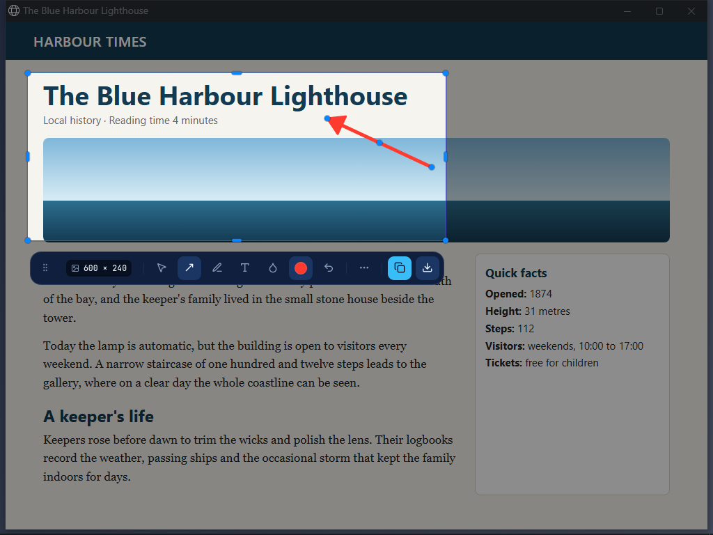
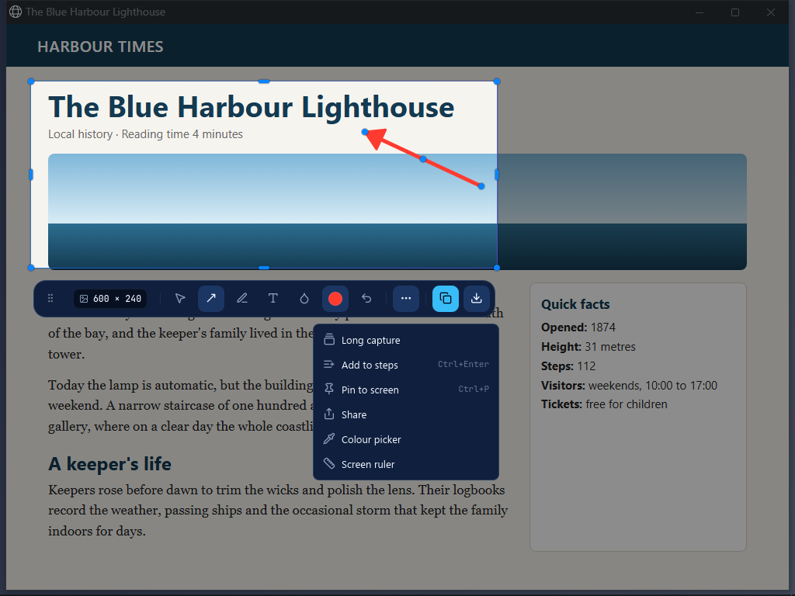
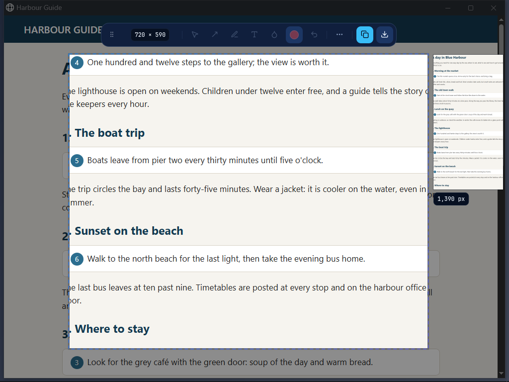
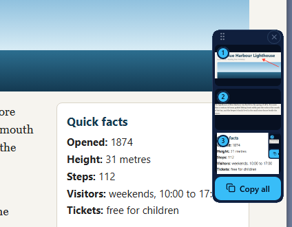

# Snip and annotate

Take a screenshot, mark it up, and paste it into an AI chat in seconds. Snip is
one flow, whichever way you start it.

  

## Take a snip

Press `Alt+A` (the default; change it in Settings > Shortcuts), choose **Snip**
in the tray menu, press the Snip button on
the bar (over a screen you already froze), or run `opencircle run snip`. The
screen freezes and a glow around its edge shows it is captured. Then:

- **Hover** a window: its whole frame is outlined, with its name and size. Click
  to take it. Scroll the wheel down to outline a part of it instead (a toolbar,
  a panel, a button; Windows), and back up to step out to the window.
- **Drag** to draw your own area; its exact size is shown. Edges snap to windows
  and their parts; hold `Shift` to place them freely.
- **Press `Enter`** for the full screen (the screen under the pointer;
  `Shift+Enter` takes all screens as one picture). An area may cross screens.

OpenCircle's own floating widgets (the Steps strip, a pin, the AI chat, a pill)
count as windows here: hover one and click to take it. They never appear in any
other capture. On Wayland there is no window list: a click takes the screen
under the pointer, like `Enter`.

**Snip with OpenCircle's own bar and chat in the picture.** When Snip starts over
the open overlay, the picture shows the screen as you see it: the bar and the
open AI chat are in it. Hover outlines them as windows, click picks them, and
Copy and Save work as usual (the AI chat is excluded from OS captures, so only
this route can take it).

**Snip a translated page.** With a translation on screen, Snip (the Snip button
in the translate pill, after the language chips, or `Alt+A`, or the tray) takes
the screen as you see it, translation included. Drag an area, or click or press
`Enter` for the screen; then mark it up, copy, save or add it to Steps as usual.

Everything also works with a finger or a pen on a touch screen. A loupe beside the pointer shows the pixels under it at 8x. `Esc` cancels.

Once an area is picked, the edge glow goes away and the area gets a soft outline
with small handles. Drag the handles to resize, drag inside to move it, use the
arrow keys to nudge (`Shift` = 10 px, `Ctrl`+arrows resize).

The same flow starts from the bar's Snip button: if you had already selected an
area, that area is the pick.

## After the pick

A pick always opens the Snip toolbar beside the area. By default a pick
copies nothing: press `Ctrl+C` or **Copy** when you want it on the clipboard.
Turn **Copy when picked** on in **Settings > Snip** to copy the area at the
moment you pick it.

Copy and Save keep the capture's **original size**. Settings > Snip can scale
the long edge down to 1024, 1568 or 2048 px instead. Copy is the picture only;
text is copied by selecting it. Drag the size chip on the toolbar to drag the
picture straight into any app, on any screen.

**Timer** (Settings > Snip: Off / 3 s / 5 s / 10 s): the overlay hides and
counts down, so you can open a menu or a tooltip first.

**Mouse pointer** (Settings > Snip, off by default) draws the pointer into the
capture.

## The toolbar

One bar, in groups: a grip to move it, the size chip, **Select**, **Shapes**,
**Draw**, **Text**, **Hide** (blur and redact), **Colour**, **Undo**, **More**,
**Copy** and **Save**. Click a tool to turn it on; click the active tool again
to open its options (outline, fill, size, and so on). `Esc` closes the toolbar.

**More** holds three actions on the picked area, then Open in Studio, Long
capture, Add to steps, Share (Windows), Colour picker and Screen
ruler:

- **Copy text** puts the text of the area on the clipboard.
- **Ask AI** opens the AI chat with the picture, drawings included (with no AI
  key the picture opens in Google in your browser, as Ask AI does from the bar).
- **Translate** translates the text in place inside the area; the row then says
  **Show original**. Copy, Save and drag-out give the translated picture.

Each of the three shows your own shortcut for the same action (Settings >
Shortcuts; by default `Ctrl+Shift+X`, `Ctrl+Shift+E`, `Alt+Shift+T`), and that
key acts on the area while Snip is open. The area is read once, when More opens.
Copy text and Translate read the capture under your drawing and never the parts
you hid with Blur or Redact (or that a Spotlight dims). During a long capture,
Copy text and Ask AI finish the capture first; Translate is off.

  

Every tool has a key:

| Tool | Key |
|---|---|
| Select | `V` |
| Rectangle / Ellipse | `R` / `O` |
| Arrow (drag the middle to curve it) | `A` |
| Pen (rough shapes snap to clean ones) | `P` |
| Highlighter | `H` |
| Eraser (takes drawings off, never the picture) | `X` |
| Text | `T` |
| Callout | `C` |
| Numbered step | `N` |
| Hide (blur) | `B` |
| Redact | `K` |
| Spotlight (dims everything else) | `S` |
| Magnifier | `M` |

`Ctrl+Z` undoes, `Ctrl+Y` or `Ctrl+Shift+Z` redoes, `Ctrl+V` pastes a picture on the clipboard as an image, else its text (into
the text being typed, else as a new text). Annotations stay editable until you copy
or save. With a drawing tool a plain drag always draws; to move an annotation,
use **Select** or hold `Ctrl` and drag. A selected annotation shows only its own
small handles. OpenCircle remembers your last tool, colour, sizes and options.

**Hide (Blur) or Redact.** Hide covers what you don't want read, in Snip and in
the Studio alike. Its options row has:

- **Style.** *Soft* (the default) is a smooth, content-free blur built only from
  the surroundings just outside the hidden area (never from any hidden area);
  *Frost* is a calm background frost and *Pixelate* is a fine pixel mosaic. None
  of those three ever looks at the hidden text, so the text cannot be worked back
  out of them: every Hide in a picture shares one texture, so lines and
  overlapping strokes match. *Blur (look only)*, *Frosted* and *Progressive* (a
  blur that fades from one handle to the other; drag the two handles to change
  where it starts and ends) are **looks, not for secrets**: they blur what is
  there, and with a known font a blurred code can be recovered. They are never
  the default. Copy text and Translate skip every Hide, but **Ask AI receives
  the picture as you see it**: with a look style that is the blurred picture, so
  a look never keeps a secret from the AI you ask.
- **Shape.** *Brush* (a stroke with soft round ends, sized to the text line under
  it unless you pick a size; line help keeps it on its line, and sliding back
  along a held line un-hides what you left), *Rectangle* or *Ellipse* (hold
  `Shift` for a square or a circle; drag a corner handle to resize). Edges fade
  outward only, so what is inside the shape is always fully covered. **Hide this
  shape** (Snip: under the Hide options; the Studio: the Actions menu or the
  right-click menu) covers a selected rectangle, ellipse, pen stroke or arrow,
  or only its outline.
- **Strength.** Light, Medium or Strong (a quarter, a half, or one text height),
  the same at any zoom; the Studio also has a Custom slider. While Hide is the
  tool, `1`, `2`, `3` pick the strength and `Shift+B` picks the next style for the next Hide (an existing Hide is restyled by clicking a style card).

**Redact** is a solid box (or an ellipse, if you redact an ellipse), for when you
want no trace at all.

**Eraser.** Drag over a pen or highlighter stroke to take off only the part
under the brush; any other drawing it touches goes whole. Turn on **Whole
drawing** in its options to take a whole stroke at once. One `Ctrl+Z` brings
back everything one drag erased.

## OpenCircle Studio

OpenCircle Studio is a normal window for longer work on a picture: the same editor
as the Snip toolbar, with a bigger canvas. Open it from the tray (**Studio**), the
Start menu or app grid, **Open in OpenCircle Studio** on the Snip toolbar (`Ctrl+E`,
or double-click the picked area; your drawings stay editable), "Open with" on an
image file, or a terminal: `opencircle studio [file]`. Only one Studio is open at a
time: opening it again brings it to the front and opens the new picture in it.

- **Open pictures:** `Ctrl+O` (pick several at once), drop files on the window, or
  `Ctrl+V` with a picture on the clipboard. File > Open recent and the start screen
  list your latest files.
- **Tools and options:** every tool is on the rail at the window's edge. The bar above
  the canvas always shows the colour, size, opacity and outline / fill (dimmed where a
  tool can't use them), then the tool's own options, then **Position** and
  **Actions**.
- **Select and copy:** click, `Shift`+click, drag a box or `Ctrl+A` to select drawings.
  `Ctrl+C` / `Ctrl+X` / `Ctrl+V` / `Ctrl+D` / `Delete` act on the selected drawings;
  with nothing selected `Ctrl+C` copies the whole picture. The **Copy** button and
  `Ctrl+Shift+C` always copy the whole picture. Right-click for the same actions.
- **Actions on the picture:** Copy text, Translate, Ask AI, Edit text (change the
  words in the picture) and Cut out (remove the background).
- **Steps:** the sidebar holds several pictures as numbered steps (**Add step** > Pictures, Paste or This picture,
  drop, paste; click a step to edit it, drag to reorder). **Export** writes the steps
  or one picture as images, or a walkthrough as GIF, MP4 or WebM with a transition
  (Cut, Crossfade, Slide, Push, Zoom or Wipe) of 0.3, 0.5 or 1 s; the sheet shows the
  file's expected size. The sidebar starts closed while there are no steps and opens with the first one; `Ctrl+B` hides or shows it.
- **Zoom:** the mouse wheel zooms the picture at the pointer, a middle-button drag or
  `Space`+drag pans, `Ctrl+=` / `Ctrl+-` zoom it, `Ctrl+0` fits, `Ctrl+1` shows 100 %.
  The Studio's own text and controls scale in Preferences > Appearance and the View menu.
- **Preferences:** `Ctrl+,` (File > Preferences, or Settings > Studio > Open Studio
  preferences): theme, where the Steps sidebar sits, saving and export defaults,
  copy and paste, editing, and every shortcut. Settings > Studio can keep unsaved
  work if OpenCircle closes unexpectedly (off by default).
- **Saving:** closing the window or opening another picture with unsaved drawings asks
  first: Don't save, Cancel or Save. `Esc` never closes the Studio.

**Cut out** first fills a plain background at once, with nothing downloaded. For
other backgrounds it can use a background-removal model (about 179 MB, from
`github.com/AmerAlreyahi/OpenCircle-models`, checked against a pinned checksum); it
asks before downloading, and runs on your PC. Your picture is never sent anywhere.

On Wayland a file can't be dropped on the window yet (use `Ctrl+O` or `Ctrl+V`).

## Long capture

For a page taller than the screen: pick the area, then the **Long capture** button (before More).
Scroll the page yourself (wheel, scrollbar or keys); OpenCircle stitches what
passes through the area into one tall image and shows the whole page so far
beside it. Scrolling back up adds nothing twice, and bars that stay put (a site's
header, a chat's message box) are kept once. **Copy** or **Save** finishes it.

  

It stops at 20,000 px by default (Settings > Snip > Long capture: 5,000, 10,000
or 20,000). Nothing is scrolled for you, and only the area is grabbed.

On Wayland the page so far, with Copy, Save, Done and Cancel, shows in a small
pop-up beside the area, and the tray icon shows a record dot while it runs: see
[Linux notes](linux-notes.md#long-capture-on-wayland).

## Steps

**More > Add to steps** (`Ctrl+Enter`) puts the capture, with its annotations, on
a small floating strip and closes the overlay, so you can go to another window or
screen. Each next snip becomes the next numbered step. Click a step to copy it,
drag to reorder, double-click to edit it, `x` to delete. **Copy all**
(`Ctrl+Shift+C`) puts every step on the clipboard as one numbered image, handy
for explaining a process to an AI. Up to 12 steps; they are kept in memory only.

  

## Colour picker and screen ruler

- **Colour picker:** a loupe follows the pointer. Click copies the colour as
  `#RRGGBB`; `Shift`+click copies `rgb(r, g, b)`. The last eight colours stay in
  the toolbar for this run.
- **Screen ruler:** measure a line (any angle; `Shift` for 0/45/90), a run of
  like colour across or up and down, or a box. Sizes are in real pixels.
  `Ctrl+C` copies the reading.

Both are in More, and can have their own shortcut (unset by default: see
[Shortcuts](shortcuts.md)).

## Pin

**Pin** is one button on the toolbar (just before Long capture); `Ctrl+P` does the same. A click keeps the image on screen in a small always-on-top window. Hover the button and the row under the toolbar shows **Pin | Live pin** (your choice is remembered; Live pin only while Labs > Pins is on).
Drag it, scroll to zoom, hover for Copy, Save and Close; `Esc` or a double-click
closes it. **Live pin** (a Labs feature, Settings > Labs > Pins; Windows, over a live screen) keeps a
window's picked area updating live in a pin.

## Save

**Save** (`Ctrl+S`) writes a PNG or JPEG where you choose, starting in the folder
from **Settings > Snip**. Nothing is written to disk until you save.

**Recent** (Settings > History, off by default) keeps your last captures on this
PC only; turning it off deletes them.
