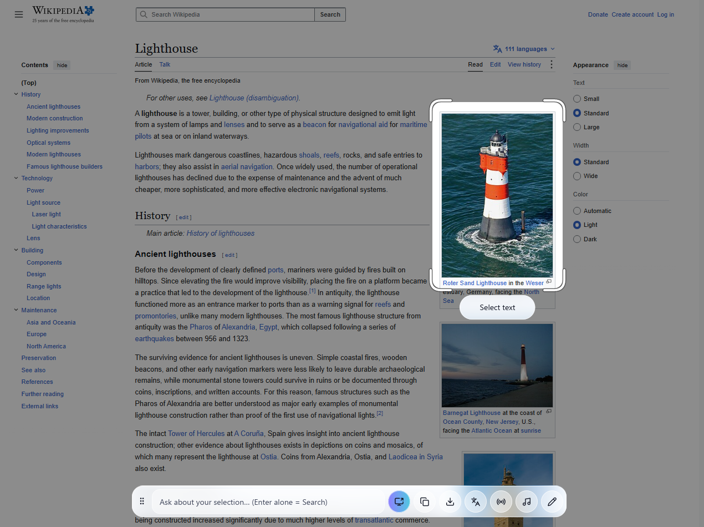
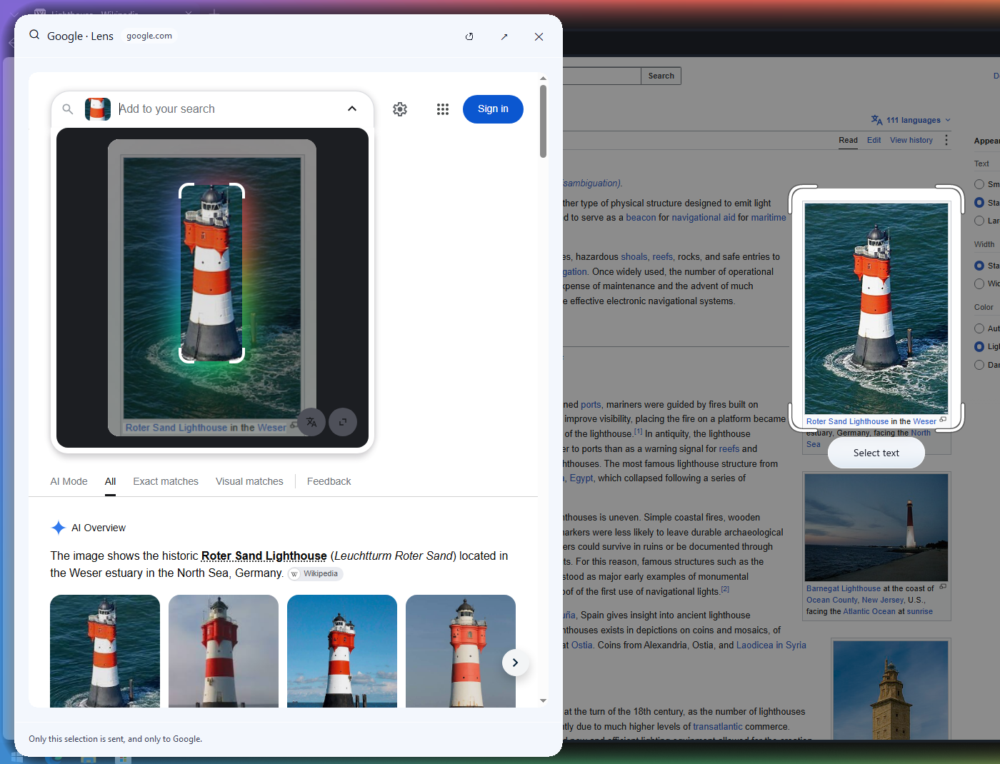
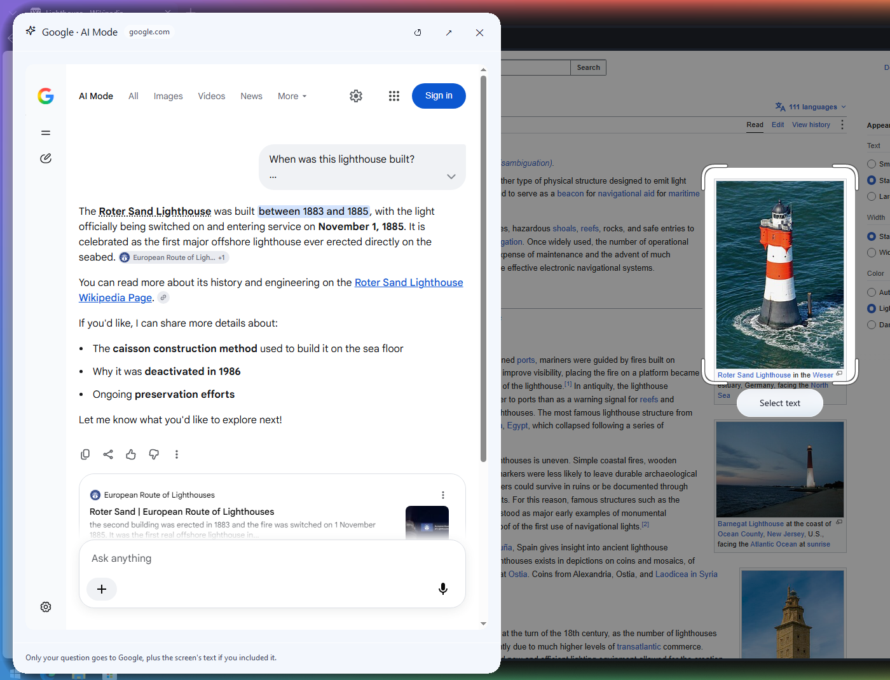
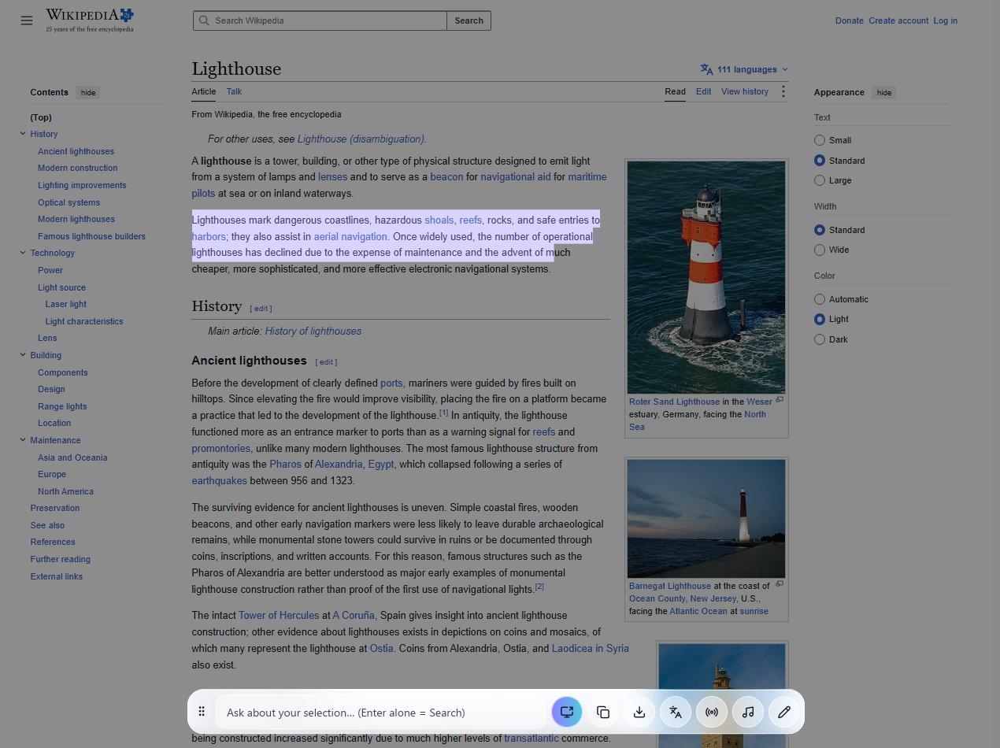
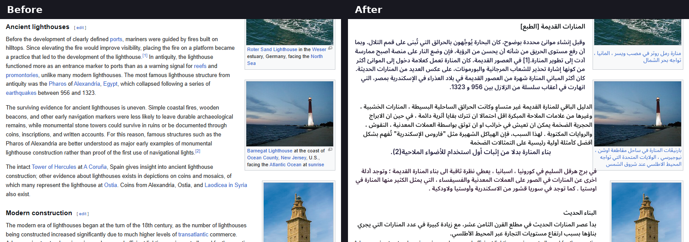
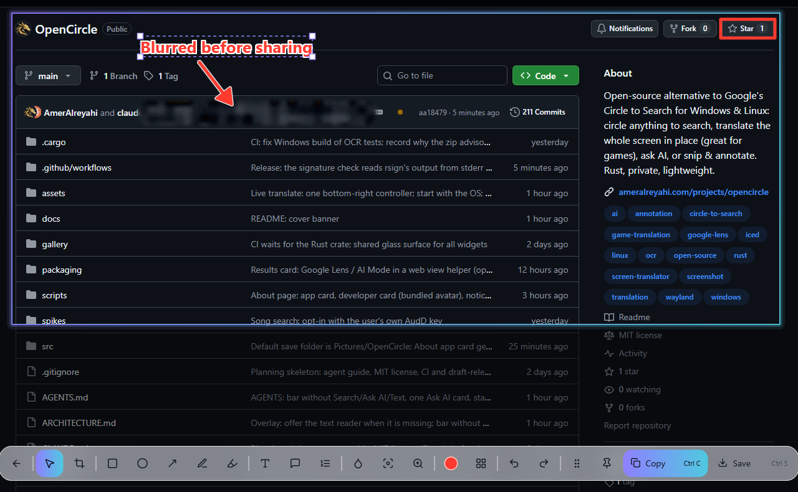
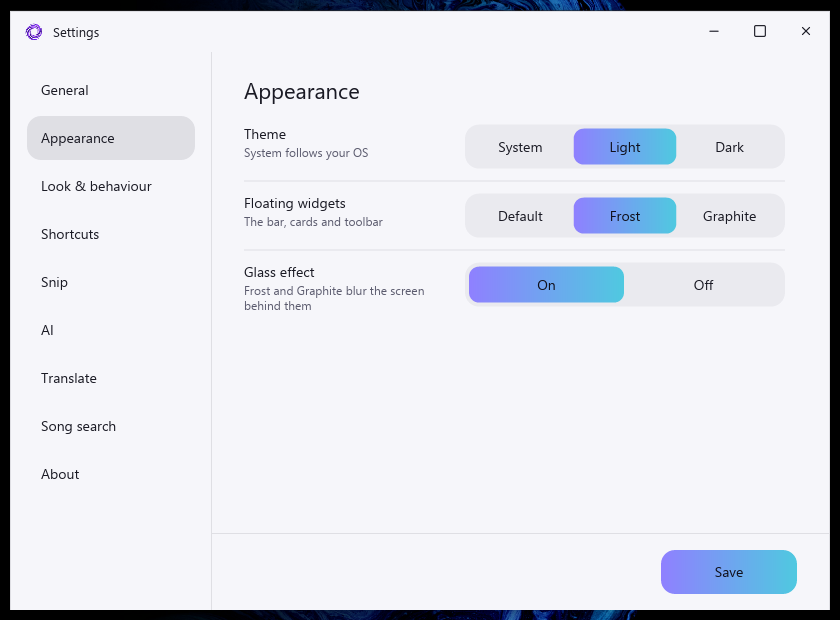
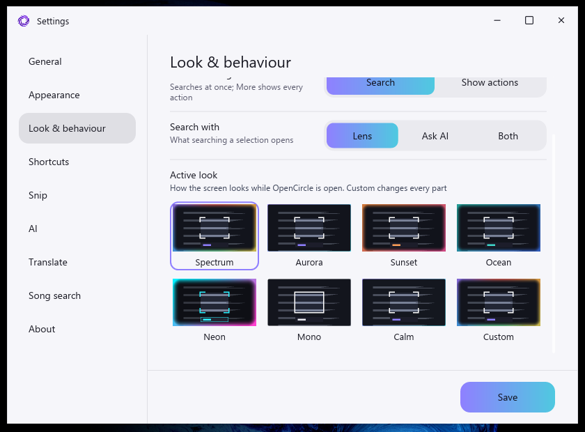
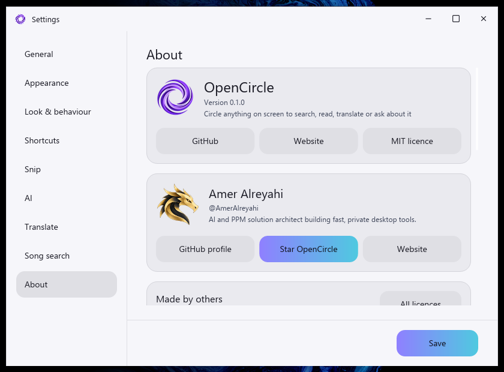
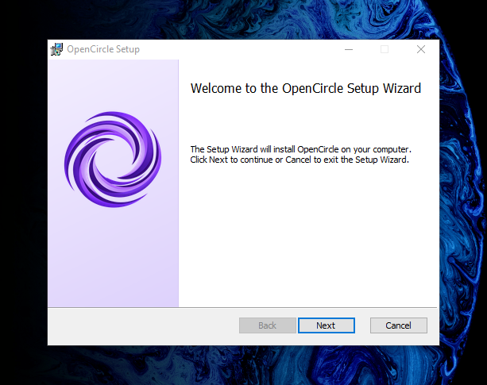

# Gallery

Real screenshots of OpenCircle 0.1.0 on Windows 10, with the Frost widget
theme and the default live look. The pages are ordinary Wikipedia and GitHub
pages; nothing is mocked up.

### Circle to search
Press the shortcut, circle anything. The stroke snaps to a rounded box with
corner brackets, and the bottom bar offers your question, Copy, Save,
Translate, Live translate, Music and Edit.

### Results in a card
Google Lens opens in a floating card on the side away from the selection, not
in a new tab. Dock it left or right, drag it, resize it.

### Ask AI
Type a question about your selection and the answer opens in the same card
(Google AI Mode here; add your own key to answer inside OpenCircle).

### Select text
Drag over words like on a desktop, then copy, translate or search them.

### Translate the whole screen, in place
`Ctrl+Shift+T`: the English text is erased and the Arabic translation is drawn
where it stood.

### Snip and annotate
Arrows, shapes, text, numbered steps, spotlight and an irreversible blur, in
the same bar. Copy for an AI chat or save.

### Settings
| Appearance | Look and behaviour |
|---|---|
|  |  |

### About

### Installer

