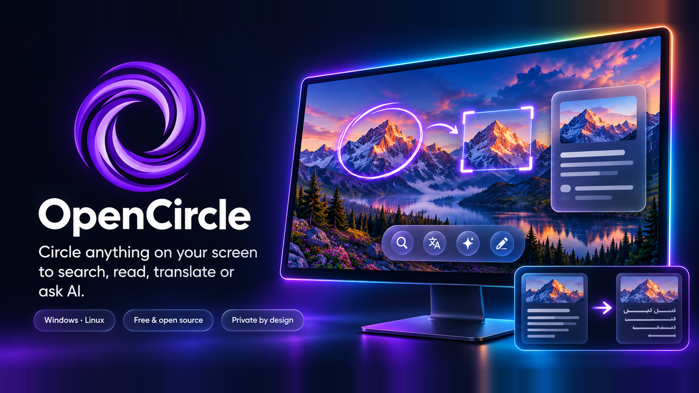

# Gallery

## OpenCircle v0.1.1 in action

Real recordings of OpenCircle 0.1.1 on a Windows test machine. The pages are
local demo pages with a NASA photo; nothing in the app is mocked up. Each clip is
also available as an MP4. Only working default features are shown here; Labs
features are off. See the [v0.1.1 release notes](https://github.com/AmerAlreyahi/OpenCircle/releases/tag/v0.1.1).

| | |
|---|---|
|  [Circle anything, then choose Search](../docs/features/circle-to-search.md) ([MP4](clips/clip-1-circle.mp4)) |  [Select text. Copy. Paste.](../docs/features/select-text.md) ([MP4](clips/clip-2-text.mp4)) |
|  [Read the page in Arabic](../docs/features/translate.md) ([MP4](clips/clip-3-translate.mp4)) |  [Tip: Alt+drag moves the box](../docs/features/selection-box.md) ([MP4](clips/clip-4-adjust.mp4)) |
|  [Keep it with Ctrl+S](../docs/features/save-and-copy.md) ([MP4](clips/clip-5-save.mp4)) |  [Install. Launch. Ready.](../docs/features/install.md) ([MP4](clips/clip-6-install.mp4)) |

These clips cover Circle to Search, text selection and copy, offline in-place
translation (after the first model download), selection adjustment, image
copy/save, and the Windows installer.

The numbered PNG files in this folder are older v0.1.0 screenshots and do not
represent the current default interface. Snip/editor, song search, history,
pins and live translate are unfinished Labs features, hidden and off by default.
