# Gallery

> These are **design concepts**, not screenshots of the running app. They will
> be replaced with real screenshots as features land.

### Translate the whole screen, in place
Before and after: the original text is erased and the translation drawn in
its place — same colours, same position, no boxes.

| Before | After |
|---|---|
| 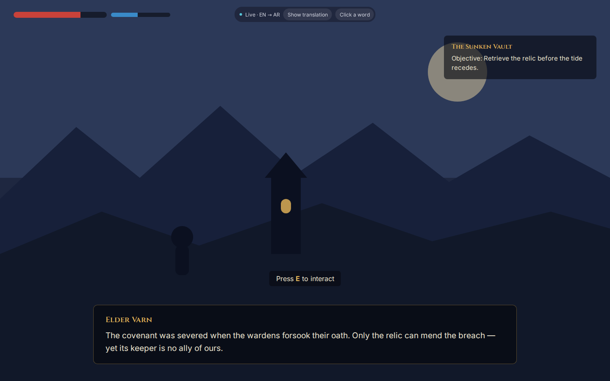 | 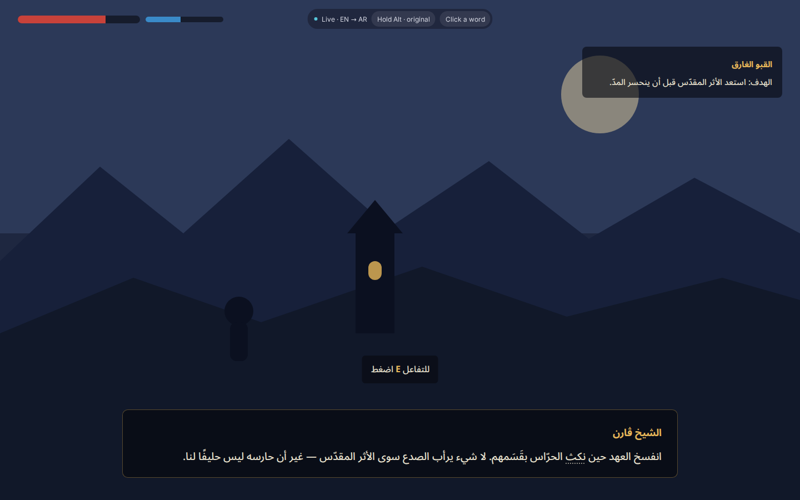 |

Click a word for its meaning in context:

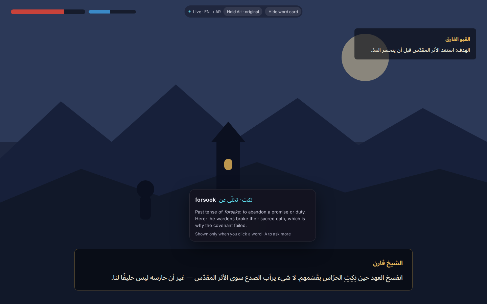

### Circle to search

Click **Edit** and the same bar turns into an editing toolbar (shapes, arrows, pen, highlighter, text, steps, blur, spotlight, crop, colours, undo/redo); the back arrow returns to the actions:

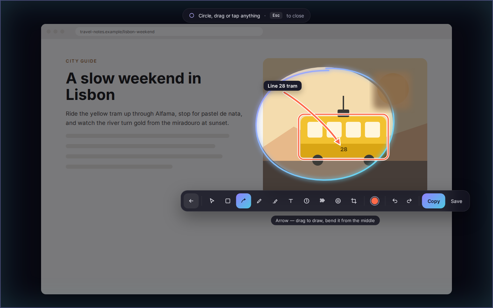

One colour button opens the picker (12 colours, stroke width, custom colour):

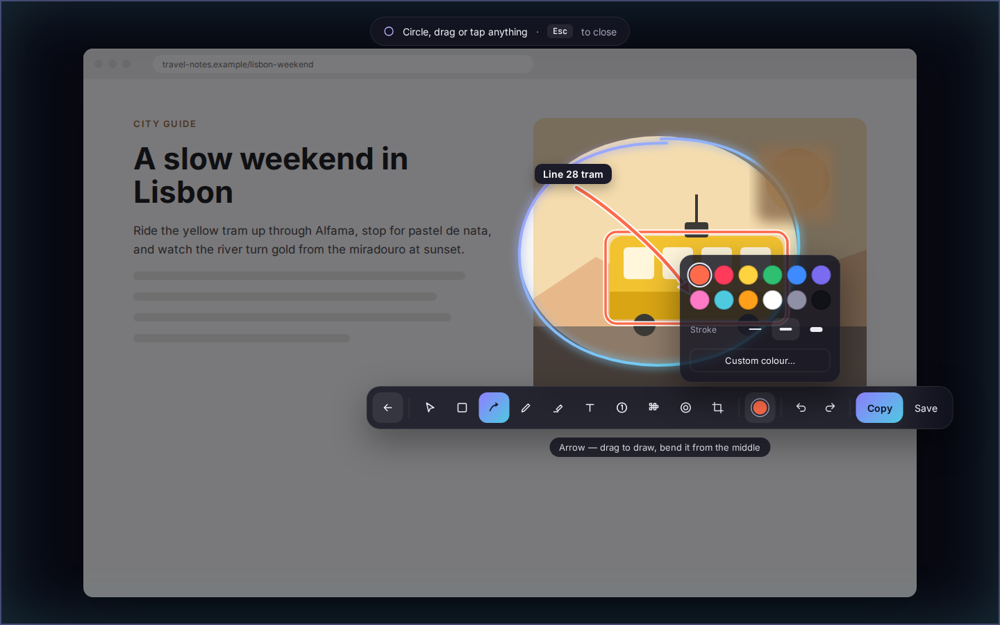

### Ask AI
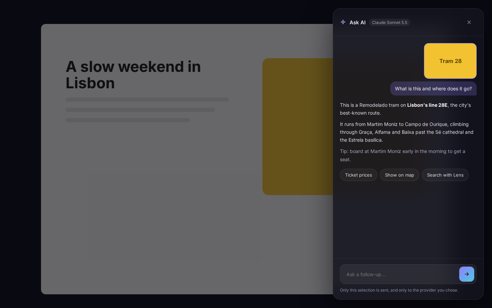

### Copy or translate text from a selection
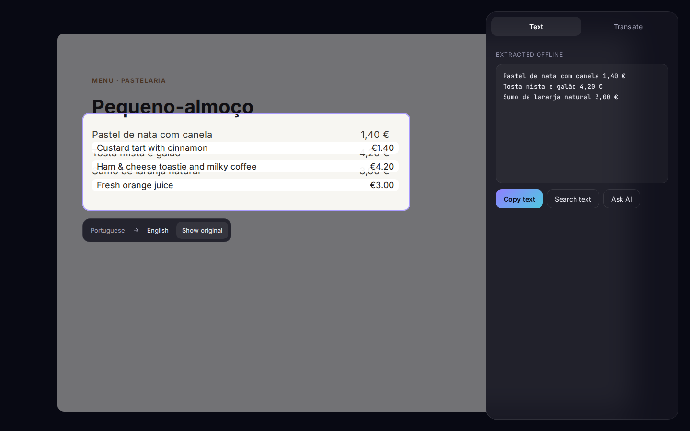

### Edit any capture: blur, shapes, arrows, text, steps
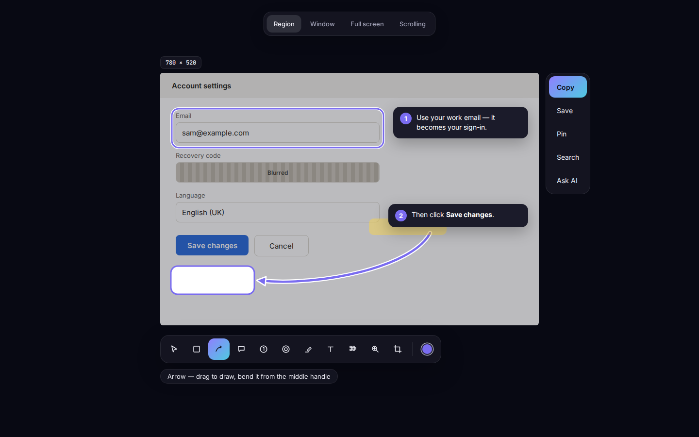

### Scrolling capture
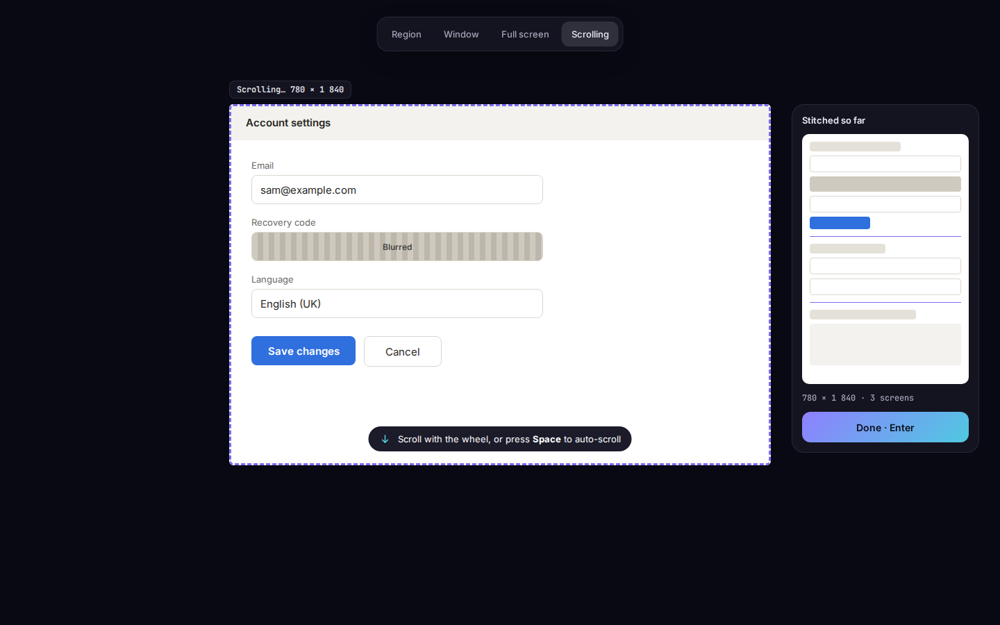

### Settings — dark and light
| Dark | Light |
|---|---|
| 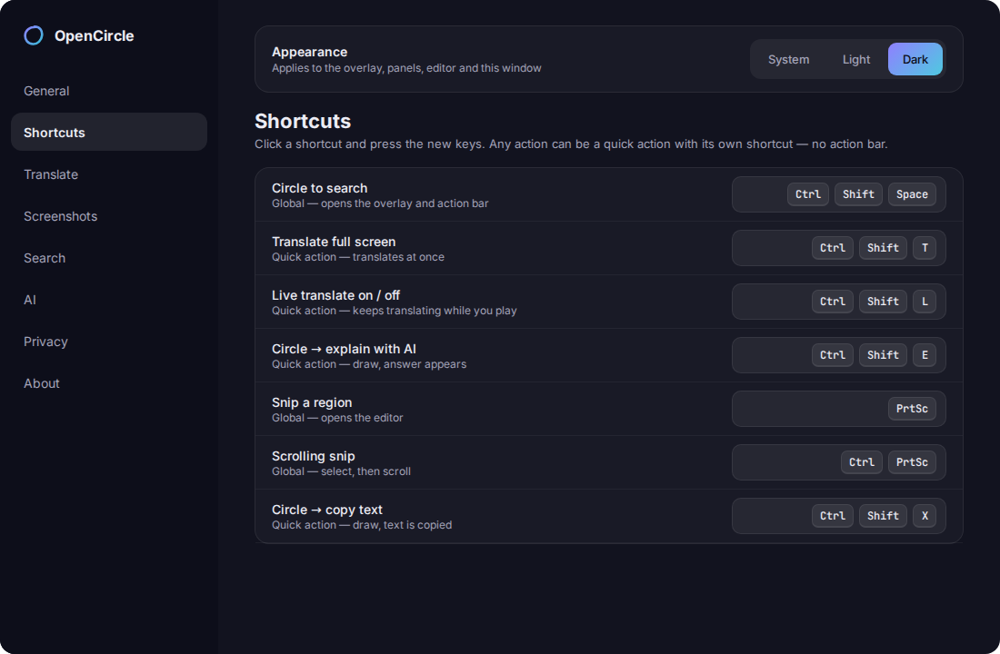 | 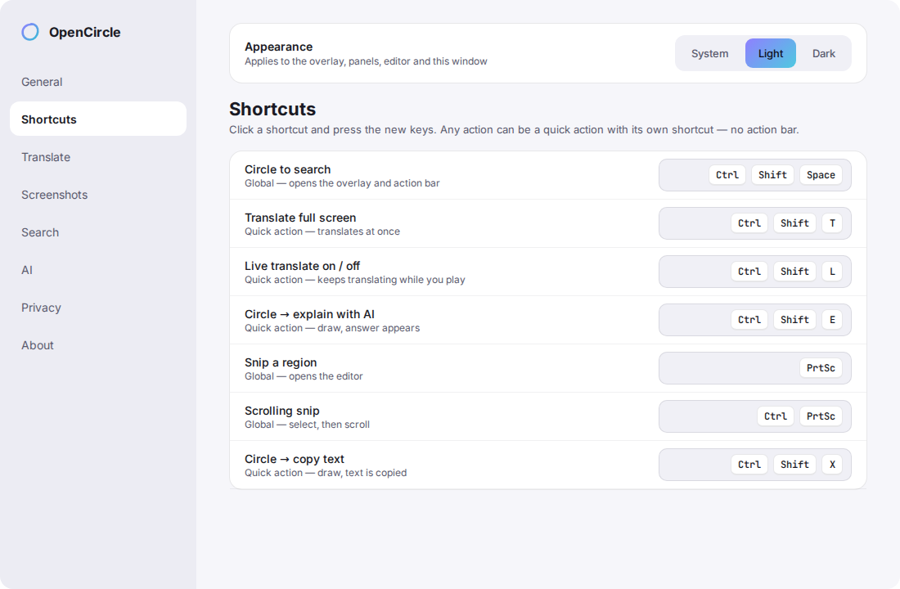 |

### First run
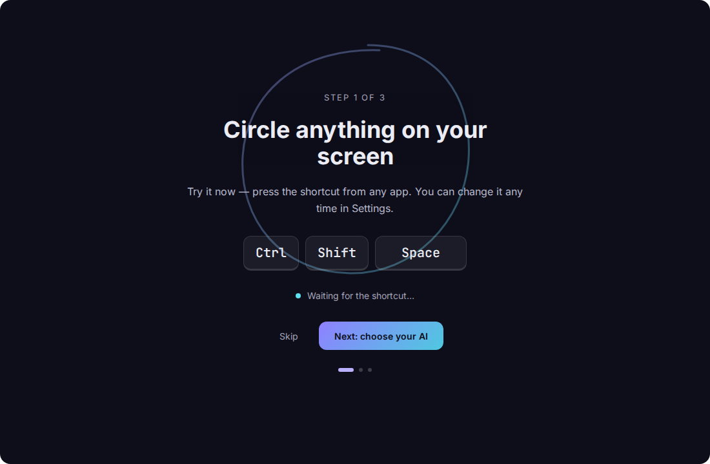
