# Gallery

Pictures and short recordings of OpenCircle on Windows. The screenshots use a
local demo page with original text; nothing in the app is mocked up. The
recordings are the clips bundled in the app (`assets/previews`): each plays at
the top of its Settings page. Third-party material in them is credited in
[NOTICE](../docs/NOTICE.md) and in Settings > About.

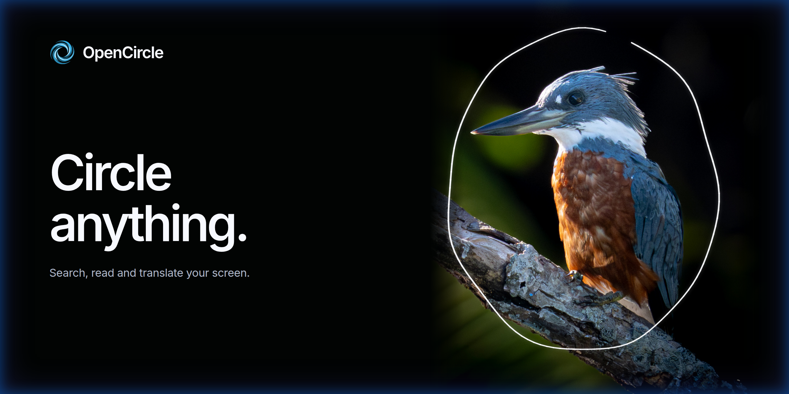

## Pictures

| | |
|---|---|
| 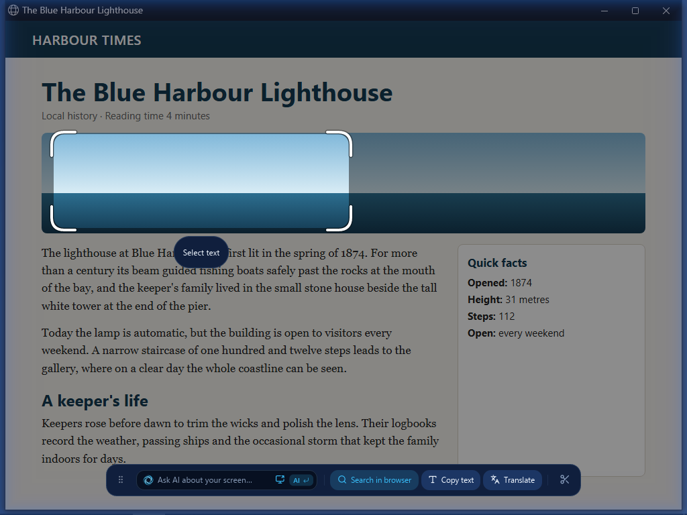 Circle, then choose ([guide](../docs/features/circle-to-search.md)) | 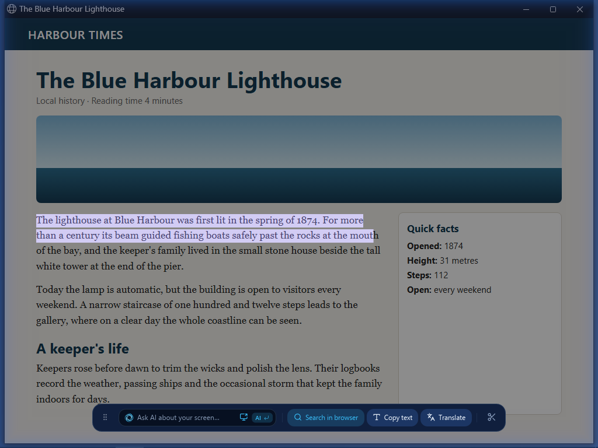 Select text ([guide](../docs/features/select-text.md)) |
|  Snip and annotate ([guide](../docs/features/snip.md)) | 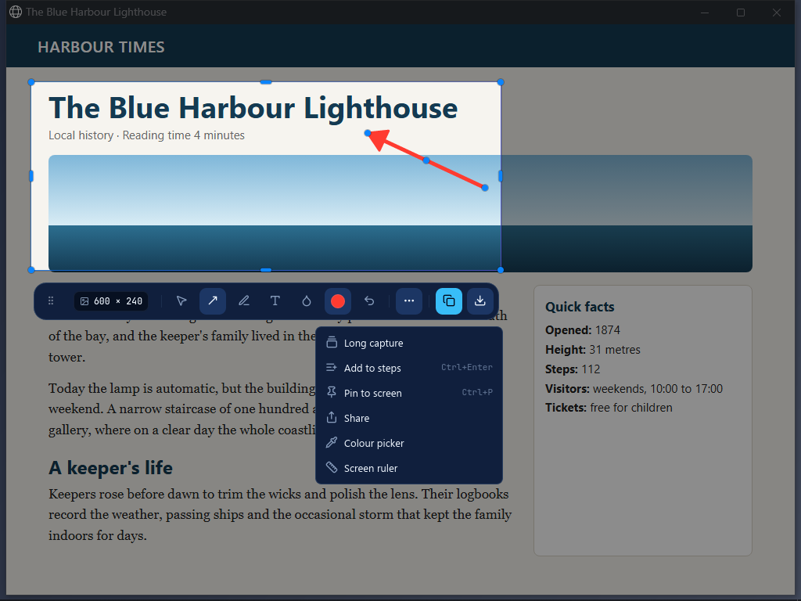 More: long capture, steps, pin, share, picker, ruler |
| 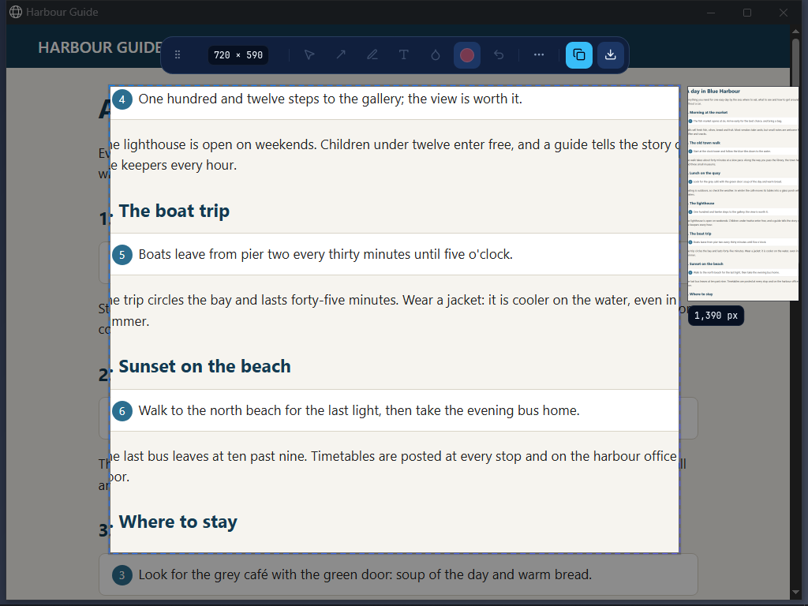 Long capture | 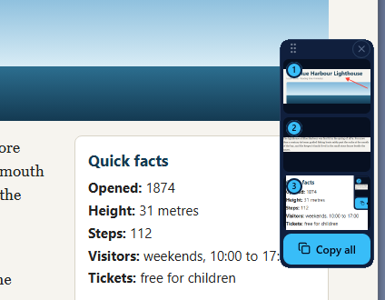 Steps strip |
| 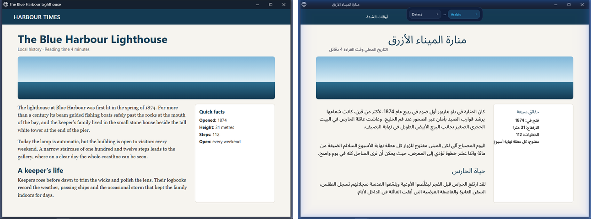 Translate in place ([guide](../docs/features/translate.md)) | 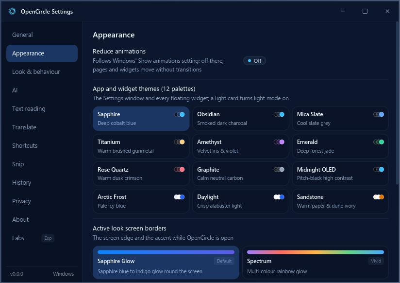 Settings > Appearance: 12 themes, Sapphire Glow |

## Recordings

| | |
|---|---|
| 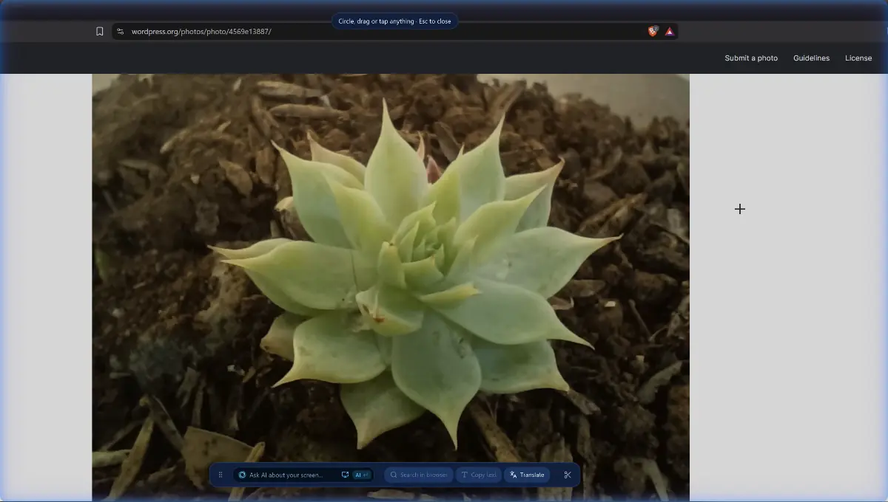 Circle anything ([also 2](../assets/previews/circle-2.webp), [3](../assets/previews/circle-3.webp)) | 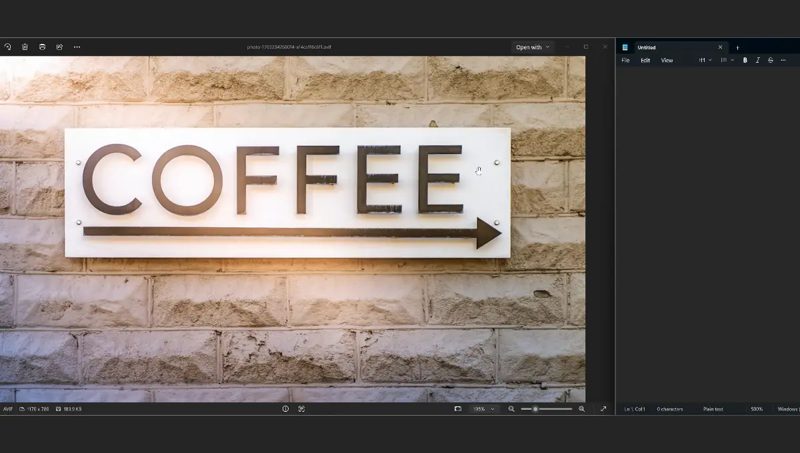 Select text |
| 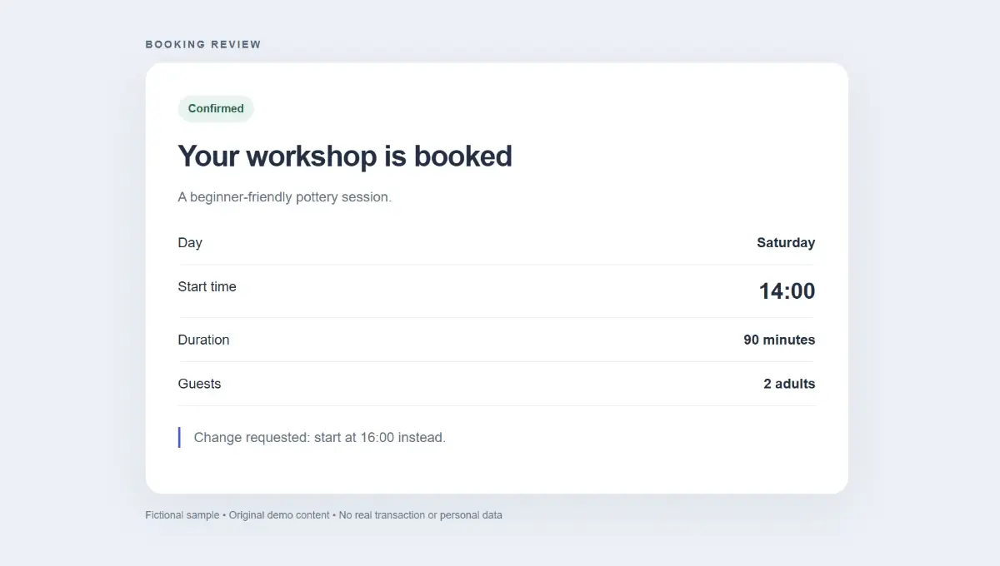 Snip and Blur | 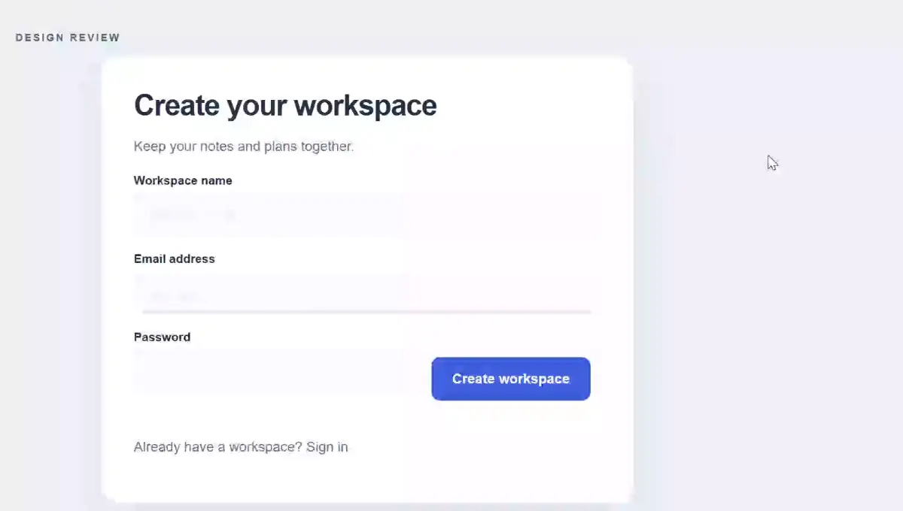 Snip with a comment |
| 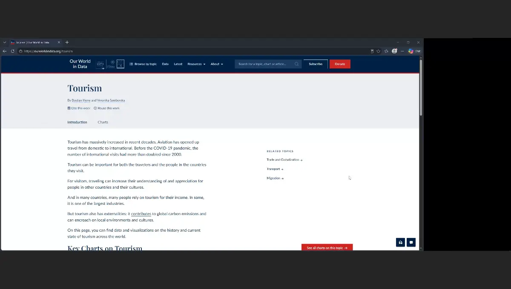 Long capture | 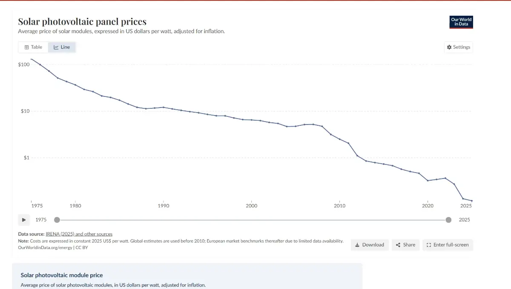 AI chat |
| 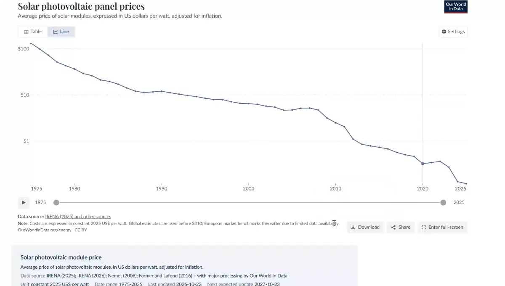 Ask AI in your browser | |

Song search, search history, live pins and live translate are unfinished Labs
features, off by default and not shown here.
